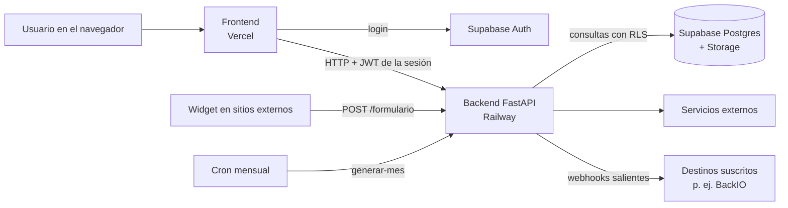

# 00 · Arquitectura de prometIO

> Revisado contra el código el 13/10/2026.

prometIO es el CRM interno de Geeks Ecuador. Reúne en un solo lugar lo que necesita el equipo comercial: contactos y
empresas, el pipeline de oportunidades, las cotizaciones con su motor de márgenes, los contratos de fee recurrente, la
agenda, la bandeja de conversaciones, el formulario web y los tableros. Lo usa un equipo chico (el diseño original
calculaba entre 5 y 10 usuarios) y está pensado para eso: pocas piezas, reglas claras y permisos que no dependen de la buena voluntad de la
pantalla.

## Las piezas

| Pieza | Qué hace | Dónde vive |
|---|---|---|
| Frontend | La aplicación web que usa el equipo: pantallas, formularios, tableros | Repo `prometio-frontend`. React + Vite + TypeScript, en Vercel (`https://prometio.vercel.app`) |
| Backend | Toda la lógica de negocio: API REST, motor de márgenes, PDF, integraciones, webhooks | Repo `prometio-backend`. FastAPI (Python), en Railway, región US East |
| Supabase | Login (Auth), base de datos Postgres con RLS y almacenamiento de archivos | Proyecto gestionado de Supabase |

Los dos repos son independientes a propósito ([ADR-011](./decisiones.md#adr-011)): se trabajan en paralelo sin pisarse.
El contrato entre ambos es el modelo de datos del backend (`docs/DATA_MODEL.md`) más el OpenAPI que FastAPI genera.
Ver [Arquitectura del frontend](./15-arquitectura-frontend.md) y [Arquitectura del backend](./16-arquitectura-backend.md).

## Cómo se conectan

Lo que pasa en cada tramo:

- **Login.** El frontend usa Supabase Auth (email y contraseña, o Google) y obtiene un JWT. Es lo único que el
  frontend le pide directo a Supabase.
- **Todo lo demás va por el backend.** Contactos, pipeline, cotizaciones, bandeja: el frontend llama a la API con el
  JWT de la sesión (`apiFetch` en `src/lib/api-client.ts`). El backend verifica la firma del token contra las claves
  públicas de Supabase, carga el perfil del usuario y decide qué puede hacer.
- **La base aplica RLS.** Las políticas de Postgres repiten la matriz de permisos. Si alguien intentara hablarle a la
  base sin pasar por el backend, la base igual filtra.
- **Servicios externos.** Solo el backend habla con ellos. Las claves viven en sus variables de entorno, nunca en el
  navegador.

| Servicio | Para qué |
|---|---|
| Google Calendar y Meet | Sincronizar actividades y generar enlaces de videollamada, con token por vendedor |
| Contífico | Consultar facturas emitidas e historial de precios. Solo lectura: la emisión de facturas está diferida |
| Apify | Enriquecer empresas y buscar leads en LinkedIn |
| Resend | Recibir estadísticas de email y bajas de marketing por webhook |
| Meta Conversions API y GA4 | Registrar como conversión los leads del formulario web |
| Basecamp | Conectar la cuenta de cada vendedor (nombre y foto) y chequear disponibilidad |
| Claude API | Borrador del documento de alcance, sugerencias de líneas y de inicio |
| PageSpeed Insights | Core Web Vitals en la pantalla de SEO |
| hCaptcha | Proteger el formulario web |

Ver [Integraciones](./11-integraciones.md).

### Por qué un backend propio y no todo en Supabase

Supabase resuelve la mayor parte (datos, permisos, login, archivos). FastAPI existe para lo que no cabe bien en
políticas o funciones de la base: el motor de márgenes, la generación de PDF, la orquestación de IA, los webhooks y las
integraciones. Python es además el lenguaje principal del equipo ([ADR-004](./decisiones.md#adr-004)).

### Por qué el frontend no lee la base directo

Porque la lógica de negocio (cálculo de cotizaciones, transiciones de estado, auditoría, webhooks) vive en un solo
lugar. Si el frontend leyera y escribiera tablas, cada regla tendría que repetirse en la pantalla y se desalinearía.

## Reglas que no se rompen

Vienen del diseño original y se sostienen en el código. Antes de cambiar una, lee su porqué en el
[registro de decisiones](./decisiones.md).

1. **Un contacto, tres etapas.** Contacto, lead y cliente son valores de `contacto.etapa_ciclo_vida`, no tablas
   distintas. Separarlos duplicaría datos y obligaría a sincronizarlos.
2. **Todo lleva `organizacion_id`.** Hoy hay una sola organización, pero cada registro de negocio la referencia para
   poder clonar el sistema a otra empresa sin rehacer el modelo.
3. **Los permisos viven en la base y en el backend, no en la pantalla.** La interfaz esconde lo que no te corresponde
   por comodidad, pero la barrera real son las políticas RLS y las verificaciones del backend. Ver
   [Roles y permisos](./01-roles-permisos.md).
4. **El costeo interno es por rol, nunca por persona.** Las tarifas internas dicen cuánto cuesta una hora de
   «Diseñador Jr», no de una persona con nombre. Así nadie ve sueldos dentro del CRM.
5. **El motor de márgenes tiene tres capas y no se simplifica.** Costo del proveedor, más margen de agencia, más
   comisión de agencia (calculada sobre el precio con margen), más impuesto. La tasa de impuesto está en Configuración,
   nunca en el código. Ver [Cotizaciones](./03-cotizaciones.md).
6. **El PDF se genera en el servidor.** El backend decide qué versión entrega (para cliente o interna) según quién la
   pide. La del cliente nunca muestra costo ni margen. Si el frontend recibiera el desglose para decidir si mostrarlo,
   esconderlo en pantalla no bastaría.
7. **Los montos en la interfaz van sin IVA.** Cotizaciones, valor de oportunidades, contratos y tableros muestran el
   subtotal. El IVA aparece solo donde corresponde, en el total del PDF.
8. **El valor de una oportunidad siempre dice de dónde sale.** Se muestra como «estimado» (valor referencial) hasta que
   hay una cotización aprobada; desde ahí manda el valor cotizado.
9. **Una conversación no es un contacto hasta que alguien hace clic.** Un mensaje entrante no crea un contacto. El
   usuario decide cuándo convertirla con «Convertir a contacto».
10. **Un solo pipeline de nueve etapas.** La vista por servicio es un filtro sobre el mismo tablero, no otro pipeline.
11. **Los números de documento salen de una secuencia de Postgres**, no de contar filas: contar falla cuando dos
    cotizaciones se crean a la vez.

## Fechas y zona horaria

prometIO trabaja en hora de Ecuador, con desfase fijo de −05:00 (sin horario de verano). Los rangos de día calendario
se calculan con ese desfase en el frontend (`src/lib/rango-datetime-ecuador.ts`) y el backend agrupa las series diarias
en `America/Guayaquil`, porque la base guarda en UTC.
