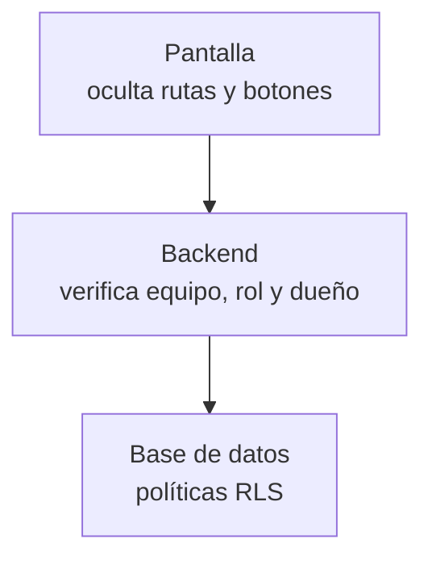

# 01 · Roles y permisos

> Revisado contra el código el 13/10/2026.

Qué ve y qué puede hacer cada persona en prometIO, y dónde se decide. La regla de fondo es simple: **la pantalla
esconde, pero quien decide es el backend y la base**. Si un botón no aparece es por comodidad; si alguien llama a la
API sin pasar por la pantalla, la respuesta es la misma: 403.

## Los equipos

Cada usuario tiene un perfil con un equipo (`perfil.equipo`). Si es de ventas, además tiene un rol
(`perfil.rol_ventas`).

| Equipo | Rol | Para quién es |
|---|---|---|
| `administrativo` | — | Dirección y administración. Ve todo y configura el sistema |
| `ventas` | `vendedor` | Ejecutivos comerciales. Ven y editan solo lo propio |
| `ventas` | `supervisor` | Jefatura comercial. Ve todo el equipo comercial y aprueba excepciones |
| `marketing` | — | Equipo de marketing. Sin acceso al módulo de ventas |
| `proveedores` | — | Analista de proveedores. Solo gestiona proveedores |

El equipo `proveedores` se agregó el 01/09/2026 ([ADR-019](./decisiones.md#adr-019)). Se descartó resolverlo con una
marca sobre `administrativo`: ese perfil seguiría pasando todas las verificaciones de admin y habría que excluirlo
endpoint por endpoint, con el riesgo de olvidar uno. Un equipo nuevo queda bloqueado de todo por defecto y solo se le
abre lo que necesita.

## Qué ve cada uno

| Módulo o acción | Admin | Vendedor | Supervisor | Marketing | Proveedores |
|---|---|---|---|---|---|
| Pipeline, oportunidades | Todo | Lo propio | Todo el equipo | No | No |
| Cotizaciones | Todo | Lo propio | Todo el equipo | No | No |
| Contratos de fee recurrente | Todo | Los de sus oportunidades | Todo el equipo | No | No |
| Contactos, empresas, Resumen, Cumpleaños | Sí | Sí | Sí | No (en la interfaz) | No |
| Agenda (actividades, calendario, timeline) | Sí | Sí | Sí | No | No |
| Dashboard, alertas, facturas | Sí | Sí | Sí | No | No |
| Bandeja | Todo | Sin asignar o asignadas a sí | Todo | No (en la interfaz) | No |
| Prospección LinkedIn | Sí | Sí | Sí | No | No |
| Desglose de margen y PDF interno | Sí | De lo propio | Sí | No | No |
| Aprobar cotizaciones en preparación | Sí | No | Sí | No | No |
| Aprobar o rechazar documentos de alcance | Sí | No | Sí | No | No |
| Reasignar, desactivar o reactivar oportunidades | Sí | No | Sí | No | No |
| SEO | Sí | No | No | Sí | No |
| Gestión de proveedores | Sí | No | No | No | Sí |
| Configuración, usuarios, salud, auditoría | Sí | No | No | No | No |
| Activar un servicio del catálogo | Sí | No | No | No | No |

Notas sobre la tabla:

- **«Lo propio»** son las oportunidades donde el vendedor es el ejecutivo, y lo que cuelga de ellas (cotizaciones,
  contratos). El supervisor y el admin pueden alternar entre «lo mío» y «todo el equipo»; el vendedor siempre ve lo
  suyo, aunque pida otra cosa.
- **Marketing y la bandeja.** La base permite que marketing vea conversaciones sin asignar o asignadas a sí, y que
  lea contactos y empresas. La interfaz hoy no le muestra esas pantallas: `/bandeja`, `/contactos` y `/empresas` están
  dentro del módulo de ventas.
- **Meta comercial.** Admin y supervisor de ventas la gestionan (`/configuracion/meta-comercial`, con «Gestionar
  metas» desde el Dashboard), igual que permite la API.
- **Modo TV.** Lee los mismos datos del dashboard, así que necesita una cuenta con acceso a ventas: el menú lo muestra
  a admin y ventas, no a marketing. La decisión es usar
  una cuenta dedicada de equipo `administrativo`, logueada una vez en el navegador de la sala
  ([ADR-021](./decisiones.md#adr-021)).
- **Proveedores.** Cualquier usuario autenticado puede leer la lista (la usa el cotizador); crear, editar y desactivar
  es de admin y del equipo de proveedores.

## Dónde se decide

Hay tres capas. Las dos primeras son la barrera real; la tercera es comodidad.

**1. La base (RLS).** Cada tabla de negocio tiene políticas de Postgres que leen el equipo y el rol del usuario con
funciones como `es_administrativo()` o `es_vendedor()`. Es la última defensa: aplica aunque alguien hable con la base
sin pasar por el backend.

**2. El backend.** Cada endpoint declara qué necesita: `require_admin`, `require_acceso_ventas`,
`require_acceso_marketing`, `require_admin_o_proveedores` o `require_supervisor_o_admin`. Además verifica que el
registro sea tuyo cuando eres vendedor. Si no cumples, responde 403 con un mensaje claro.

**3. La interfaz.** Refleja la misma matriz para no mostrarte lo que no puedes usar:

- `src/components/auth-routes.tsx` envuelve las rutas: `AdminRoute`, `VentasRoute`, `MarketingRoute` y
  `ProveedoresRoute` te devuelven al inicio si tu equipo no corresponde. `KioskRoute` (para `/tv`) solo exige sesión.
- `src/lib/pipeline-acceso.ts` concentra las preguntas de permisos que hacen las pantallas: si puedes ver el módulo de
  ventas, si puedes ver todo el equipo, si puedes ver el desglose de una cotización. Cada función es un espejo de una
  verificación del backend y lo dice en su comentario.
- `src/components/app-nav.tsx` arma el menú lateral según el equipo.

### Por qué la pantalla no basta

Porque esconder un botón no impide la llamada. Si el permiso viviera solo en el frontend, bastaría con abrir la consola
del navegador para saltárselo. Por eso las decisiones sensibles se toman del lado del servidor. El caso más claro es el
PDF de cotización: el backend elige la versión según quién la pide, en vez de mandar el desglose completo y dejar que la
pantalla decida si mostrarlo.

## Cuentas desactivadas

Un admin puede desactivar a un usuario desde Usuarios. Desde el 13/10/2026 eso corta el acceso de inmediato, en las
tres capas:

- **Backend.** Cualquier endpoint responde 403 con el mensaje «Tu cuenta está desactivada», aunque la sesión siga
  vigente.
- **Base.** Las funciones que alimentan la RLS tratan a un perfil inactivo como si no tuviera equipo, así que ninguna
  política le da acceso.
- **Interfaz.** Al recibir ese 403, `apiFetch` muestra un solo aviso (aunque fallen varias peticiones a la vez) y
  cierra la sesión, lo que te lleva al login.

Un usuario tampoco puede cambiar su propio equipo, rol ni estado: esas columnas están protegidas en la base desde la
misma fecha. Ver [Endurecimiento](./endurecimiento.md) y [Seguridad](./14-seguridad.md).
