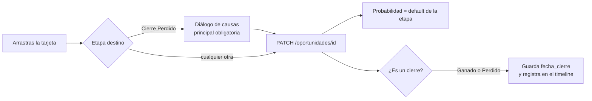

# Pipeline y oportunidades

> Revisado contra el código el 13/10/2026.

Una **oportunidad** es un negocio posible con una empresa: un contacto, una empresa, un ejecutivo responsable y un
valor. El pipeline es el tablero donde viven todas las oportunidades activas, ordenadas en 9 etapas fijas.

Esta página explica cómo se mueve una oportunidad, de dónde sale cada número de la tarjeta (valor, probabilidad,
lead score, alerta) y quién puede hacer qué.

## Qué es una oportunidad

| Campo | Qué guarda | Quién lo pone |
|---|---|---|
| `contacto_id`, `empresa_id` | Con quién se negocia | El vendedor al crearla |
| `ejecutivo_id` | El dueño comercial | Quien la crea; después solo cambia con Reasignar |
| `etapa` | En qué punto del proceso está | El vendedor, arrastrando la tarjeta |
| `valor_referencial` | El valor que estima el vendedor | El vendedor ("Valor estimado") |
| `valor_cotizado` | El subtotal sin IVA de la cotización en firme | El sistema, al enviar o aprobar una cotización |
| `probabilidad_cierre` | Probabilidad de cerrar, en % | El sistema, según la etapa |
| `categoria_interes_id` | "Interés comercial": la categoría de servicio que le interesa | El vendedor, opcional |
| `causa_perdida_principal_id` / `_secundaria_id` | Por qué se perdió | El vendedor, al cerrar como perdida |
| `fecha_ultima_actividad` | Último contacto real | El sistema, al reportar una actividad |
| `activo` | Si cuenta o no | Supervisor o admin (Desactivar / Reactivar) |

El alta es liviana a propósito: nombre, contacto, empresa, valor estimado e interés comercial. No pide servicios ni
costos. El servicio concreto se elige al cotizar (ver [Cotizaciones](./03-cotizaciones.md)).

Además del alta manual, una oportunidad nace sola en estos casos, siempre en Clasificación:

- Al convertir una conversación de la Bandeja en contacto, si se indica la empresa (ver
  [Bandeja y formulario web](./07-bandeja-formulario.md)).
- Desde el formulario web y desde la prospección en LinkedIn (ver
  [Prospección en LinkedIn](./08-prospeccion-linkedin.md)).
- Un contrato de fee que se crea sin oportunidad previa genera una ya en **Cierre Ganado**, porque un contrato
  firmado es un negocio ganado (ver [Contratos de fee y facturación](./05-contratos-facturacion.md)).

Al crear una oportunidad, si la empresa todavía no tiene datos enriquecidos, el backend lanza el enriquecimiento en
segundo plano (sector, tamaño estimado, LinkedIn). No bloquea el alta.

## Las 9 etapas

Hay un solo pipeline. Las etapas son fijas: su código, nombre y orden no se editan. Lo que sí se edita, desde
Configuración → Etapas y alertas, es la probabilidad por defecto y el umbral de alerta de cada una.

| Orden | Etapa | Código | Acción clave | Prob. default | Umbral de alerta default |
|---|---|---|---|---|---|
| 1 | Clasificación | `clasificacion` | Asignar ejecutivo e investigar la empresa | 10% | 120 h (5 días) |
| 2 | Descubrimiento | `descubrimiento` | Validar necesidad y presupuesto | 20% | 72 h |
| 3 | Presentación Inicial | `presentacion_inicial` | Reunión y casos de éxito | 35% | 72 h |
| 4 | Propuesta | `propuesta` | Documentos de servicio y cotización | 50% | 72 h |
| 5 | Evaluación | `evaluacion` | Mapear decisores | 60% | 120 h (5 días) |
| 6 | Negociación | `negociacion` | Términos, SLA y pagos | 75% | 60 h |
| 7 | Contratación | `contratacion` | Firma de contrato o NDA | 90% | 72 h |
| 8 | Cierre Ganado | `cierre_ganado` | Negocio ganado | 100% | Sin alerta |
| 9 | Cierre Perdido | `cierre_perdido` | Documentar la causa | 0% | Sin alerta |

Los valores son los de la siembra inicial. Los vigentes son los que estén en Configuración.

**Por qué un solo pipeline.** Una agencia full-service vende muchos servicios distintos, pero el proceso comercial es
el mismo. Tener un pipeline por servicio partiría la misma oportunidad en varios tableros y haría imposible sumar el
forecast. La "vista por servicio" es un filtro sobre este mismo tablero, no otra pantalla.

**Por qué el umbral va en horas.** Negociación necesita reaccionar en 48-72 horas. En días habría que escribir
"2,5 días"; en horas es un número entero.

## Mover una oportunidad (Kanban)

El tablero es un Kanban con columnas en el orden de la tabla. Mueves una oportunidad arrastrando su tarjeta a otra
columna. En móvil y en pantallas angostas el tablero hace scroll horizontal; también existe la vista de **lista**, y
la preferencia queda guardada en el navegador.

**Qué muestra.** Cada columna lleva la cantidad de oportunidades y la suma de su valor (cotizado o, si no hay,
estimado). Cada tarjeta muestra el nombre de la oportunidad, el contacto, la empresa, el lead score, los días sin
actividad con su alerta y el valor si lo tiene; el ejecutivo aparece solo al ver «Todo el equipo». Abrir y reasignar
están en el menú «⋯» de la tarjeta.

**Ganado y Perdido muestran solo los últimos 30 días.** Si no, esas columnas crecerían para siempre con negocios que
ya no están en juego. «Ver todas» abre la vista de lista filtrada por esa etapa, con el historial completo. Una
oportunidad cerrada sin fecha de cierre (datos viejos) cuenta como antigua.

El movimiento es libre: puedes avanzar, retroceder o reabrir una oportunidad cerrada. No hay orden obligatorio entre
etapas ni reglas que bloqueen un salto.

Lo que pasa solo al cambiar de etapa:

- **Aprobar una cotización gana la oportunidad** (desde el 14/10/2026). Al marcar una cotización como aprobada, la
  oportunidad pasa a Cierre Ganado con la fecha de cierre y la probabilidad de esa etapa. Si ya estaba ganada, no se
  toca. Si está en Cierre Perdido o desactivada, la aprobación se rechaza con 409: primero hay que reabrirla o
  reactivarla. Queda en la auditoría (`oportunidad.ganada_por_cotizacion`) y en el timeline como cierre. Las
  cotizaciones mensuales de un contrato no pasan por «aprobada» y no tocan la oportunidad.

- **Probabilidad.** Se reemplaza por la probabilidad por defecto de la etapa destino. Dentro de una etapa, el dueño,
  el supervisor o el admin pueden ajustarla a mano (de 0 a 100) desde el detalle de la oportunidad, con «Ajustar».
  El ajuste queda en la auditoría con el valor anterior y el nuevo, y dura hasta el próximo cambio de etapa.
  **Por qué se reinicia:** el pipeline ponderado y el forecast salen de estas probabilidades; si un ajuste manual
  sobreviviera a los cambios de etapa, un 80% puesto en Propuesta seguiría en 80% en otra etapa y el forecast
  mentiría sin que nadie lo note.
- **Fecha de cierre.** Al entrar a Cierre Ganado o Cierre Perdido se guarda `fecha_cierre` con la fecha real. Si la
  oportunidad se reabre y se vuelve a cerrar, la fecha se actualiza: el reporte de metas usa el cierre más reciente
  (ver [Dashboard, metas y forecast](./06-dashboard.md)).
- **Timeline.** Los cierres quedan registrados como evento (`oportunidad_cierre_ganado` u
  `oportunidad_cierre_perdido`).

Lo que **no** pasa solo:

- No existen reglas configurables de transición automática entre etapas. El backend las menciona como parámetro del
  Panel de Configuración, pero no están construidas.

Si un movimiento falla (por ejemplo, porque la oportunidad ya no te pertenece), el tablero muestra el error del
backend y recarga.

## Cierre Perdido y causas de pérdida

Soltar una tarjeta en Cierre Perdido no la mueve de inmediato: abre un diálogo que pide la **causa principal**
(obligatoria) y una **causa secundaria** (opcional). El backend también lo exige: mover a `cierre_perdido` sin
`causa_perdida_principal_id` devuelve 422, sin importar desde dónde llegue la petición.

Las causas salen de un catálogo editable en Configuración → Causas de pérdida. La siembra inicial trae Precio,
Competencia, Falta de presupuesto y Pérdida de contacto.

**Por qué es obligatoria.** Una pérdida sin causa no enseña nada. Con la causa registrada, el equipo puede ver si
pierde por precio, por competencia o por seguimiento.

El diálogo también pide, opcional, el **competidor que ganó** (`competidor_mencionado`), si el cliente lo mencionó.
Sirve para saber contra quién se pierde cuando la causa es "Competencia".

## Valor estimado y valor cotizado

Una oportunidad puede tener dos valores, y la pantalla siempre deja claro cuál muestra:

| Valor | De dónde sale | Cómo se muestra |
|---|---|---|
| `valor_referencial` | Lo escribe el vendedor | Con la etiqueta **estimado** |
| `valor_cotizado` | Subtotal sin IVA de la cotización en firme | Sin etiqueta: es un monto en firme |

El valor cotizado manda: si existe, es el que se ve, se suma en el dashboard y alimenta el lead score. Si no existe,
se muestra el referencial con la etiqueta "estimado".

Cómo se mueve `valor_cotizado`:

1. Cuando una cotización pasa a **enviada**, su subtotal sin IVA se copia a la oportunidad. Si ya había otra
   cotización ganada sosteniendo el valor, no se toca: un envío nunca reemplaza un "sí" del cliente.
2. Cuando una cotización se marca **aprobada**, su subtotal se copia siempre.
3. Cuando una cotización se marca **rechazada** o **vencida**, el valor se borra, pero solo si era esa cotización la
   que lo sostenía.

**Por qué sin IVA.** El IVA no es ingreso de la agencia. Todo lo que se muestra en pantalla como valor comercial es
sin IVA, y el valor cotizado sigue la misma regla. Ver [Cotizaciones](./03-cotizaciones.md).

## Lead score

Cada oportunidad trae un **lead score** de 0 a 100 que el backend calcula al leerla
(`app/core/lead_score.py`). Es determinístico: no hay IA ni modelo entrenado. Cada punto tiene una regla escrita, y
la pantalla de la oportunidad muestra el desglose por componente.

| Componente | Peso | Cómo puntúa |
|---|---|---|
| Frescura | 35 | Horas desde la última actividad reportada (o desde la creación): menos de 24 h = 35, menos de 72 h = 25, menos de 7 días = 15, menos de 14 días = 5, más = 0 |
| Seguimiento | 25 | Actividades reportadas sobre la oportunidad: 0 = 0, 1-2 = 10, 3-5 = 20, 6 o más = 25 |
| Primera respuesta | 20 | Solo si el contacto entró por la Bandeja: minutos entre el primer mensaje entrante y la primera respuesta. Menos de 15 min = 20, menos de 1 h = 15, menos de 4 h = 8, más = 3 |
| Tamaño del deal | 15 | Valor cotizado (o el estimado si no hay): sin valor = 0, menos de 500 = 5, menos de 2.000 = 10, más = 15 |
| Fit de empresa | 5 | Tamaño estimado de la empresa (del enriquecimiento): 10 personas o más = 5, menos = 2, sin dato = 0 |

El score final es `puntos obtenidos / peso aplicable × 100`, redondeado. El peso aplicable es 80, o 100 si aplica
primera respuesta.

**Por qué el peso aplicable cambia.** Un lead que nunca pasó por la Bandeja no tiene "primera respuesta" que medir.
Contarlo como cero lo castigaría por un dato que no pudo tener. Por eso ese componente se saca del denominador.

En pantalla el score se agrupa así: 70 o más es **lead caliente**, 40 a 69 es **tibio** y menos de 40 es **frío**.

### Ejemplo

Una oportunidad con la última actividad hace 2 días, 3 actividades reportadas, un valor cotizado de 1.500 y una
empresa de 11-50 personas, que no entró por la Bandeja:

| Componente | Puntos |
|---|---|
| Frescura (menos de 72 h) | 25 |
| Seguimiento (3 actividades) | 20 |
| Tamaño del deal (menos de 2.000) | 10 |
| Fit de empresa (11 o más) | 5 |
| **Total** | **60 de 80** |

Score: 60 / 80 × 100 = **75**, lead caliente.

## Alertas de estancamiento

Una oportunidad se estanca cuando pasa demasiado tiempo sin actividad en su etapa. El backend lo calcula al vuelo en
`GET /alertas` (`app/routers/alerta.py`), sin jobs programados:

- Referencia: `fecha_ultima_actividad`, o la fecha de creación si nunca tuvo actividad.
- Si las horas transcurridas superan el **umbral** de la etapa, la oportunidad queda en estado **alerta**.
- Si superan el umbral × el **multiplicador de escalamiento**, queda **escalada** (al supervisor).

El multiplicador es global, no por etapa, y vale 2 por defecto. Se edita en Configuración → Etapas y alertas o en
Márgenes e impuestos (es el mismo valor).

| Etapa | Umbral | Alerta a partir de | Escalada a partir de (×2) |
|---|---|---|---|
| Negociación | 60 h | 60 h sin actividad | 120 h sin actividad |
| Evaluación | 120 h | 5 días | 10 días |

Las etapas de cierre no tienen umbral y nunca generan alerta. Tampoco las oportunidades desactivadas.

Dónde se ve: badge en la tarjeta del Kanban, pantalla de Alertas y sugerencias de Inicio (una escalada pesa más que
una alerta). No hay notificación por correo: el supervisor ve la escalada porque ve las oportunidades de todo el
equipo.

**Qué la apaga.** Reportar una actividad sobre la oportunidad actualiza `fecha_ultima_actividad` y reinicia la
cuenta. Agendar una actividad no cuenta: solo las reportadas.

## Filtros, alcance y vistas

La barra del pipeline tiene búsqueda (oportunidad, contacto o empresa), filtro por etapa, por ejecutivo, por
servicio, el selector de alcance y el cambio de vista tablero/lista.

| Filtro | Qué hace | Quién lo ve |
|---|---|---|
| Alcance **Mío / Equipo** | Mío: solo tus oportunidades. Equipo: todas | Supervisor y admin. El vendedor siempre ve "Mío" |
| Ejecutivo | Filtra por dueño | Supervisor y admin |
| Servicio | Oportunidades con ese servicio asociado, o cuya categoría de interés es la del servicio | Todos |
| Etapa y búsqueda | Filtro local sobre lo cargado | Todos |

El alcance no es solo visual. El backend ya devuelve al vendedor únicamente sus oportunidades
(`es_solo_lo_propio` en `app/core/security.py`); el selector solo decide si un supervisor o admin quiere ver lo suyo o
lo de todos. Ver [Roles y permisos](./01-roles-permisos.md).

**Cómo filtra por servicio.** Al crear una oportunidad se elige solo la **categoría de interés**: el servicio concreto
se decide al cotizar. Por eso el filtro coincide con una oportunidad si tiene el servicio asociado (`servicios_ids`)
**o** si su categoría de interés es la categoría de ese servicio.

Si no hay oportunidades en el alcance, o ningún resultado pasa los filtros, la pantalla muestra un estado vacío, nunca
un tablero en blanco.

## Reasignar, desactivar y reactivar

Estas tres acciones son de **supervisor o admin**. El vendedor no las ve, y el backend las rechaza con 403 si llegan
igual (`require_supervisor_o_admin`).

| Acción | Endpoint | Reglas |
|---|---|---|
| Reasignar | `POST /oportunidades/{id}/reasignar` | El nuevo dueño tiene que estar activo y ser del equipo administrativo o de ventas. Marketing: 422 |
| Desactivar | `POST /oportunidades/{id}/desactivar` | No se puede desactivar una oportunidad en Cierre Ganado con una cotización ganada: 409 |
| Reactivar | `POST /oportunidades/{id}/reactivar` | 409 si ya está activa |

Las tres quedan en la bitácora de auditoría con quién lo hizo. Reasignar guarda también el ejecutivo anterior y el
nuevo.

**Por qué no se puede desactivar una ganada con cotización.** Desactivar saca la oportunidad de todos los cálculos.
Si se pudiera hacer con un negocio ganado, desaparecería en silencio de la conversión e ingresos del dashboard.

**Por qué desactivar y no borrar.** Una oportunidad desactivada sale del tablero, de las alertas y del dashboard, pero
su historia queda. Se puede reactivar.

## Endpoints

| Método | Ruta | Quién |
|---|---|---|
| `GET` | `/oportunidades` | Ventas y admin (el vendedor recibe solo las suyas) |
| `POST` | `/oportunidades` | Ventas y admin. Nace en Clasificación, con el creador como ejecutivo |
| `GET` | `/oportunidades/{id}` | Dueño, supervisor o admin |
| `PATCH` | `/oportunidades/{id}` | Dueño, supervisor o admin. Mover de etapa es un `PATCH` con `etapa` |
| `POST` | `/oportunidades/{id}/reasignar` | Supervisor o admin |
| `POST` | `/oportunidades/{id}/desactivar` | Supervisor o admin |
| `POST` | `/oportunidades/{id}/reactivar` | Supervisor o admin |
| `GET` | `/alertas` | Ventas y admin (el vendedor recibe solo las suyas) |
| `GET` | `/config/etapas-pipeline` | Cualquier usuario autenticado |

Marketing no tiene acceso a ninguno de estos endpoints. Ver el [mapa de la API](./18-api.md).
