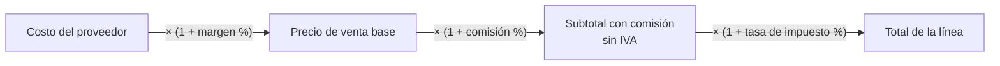
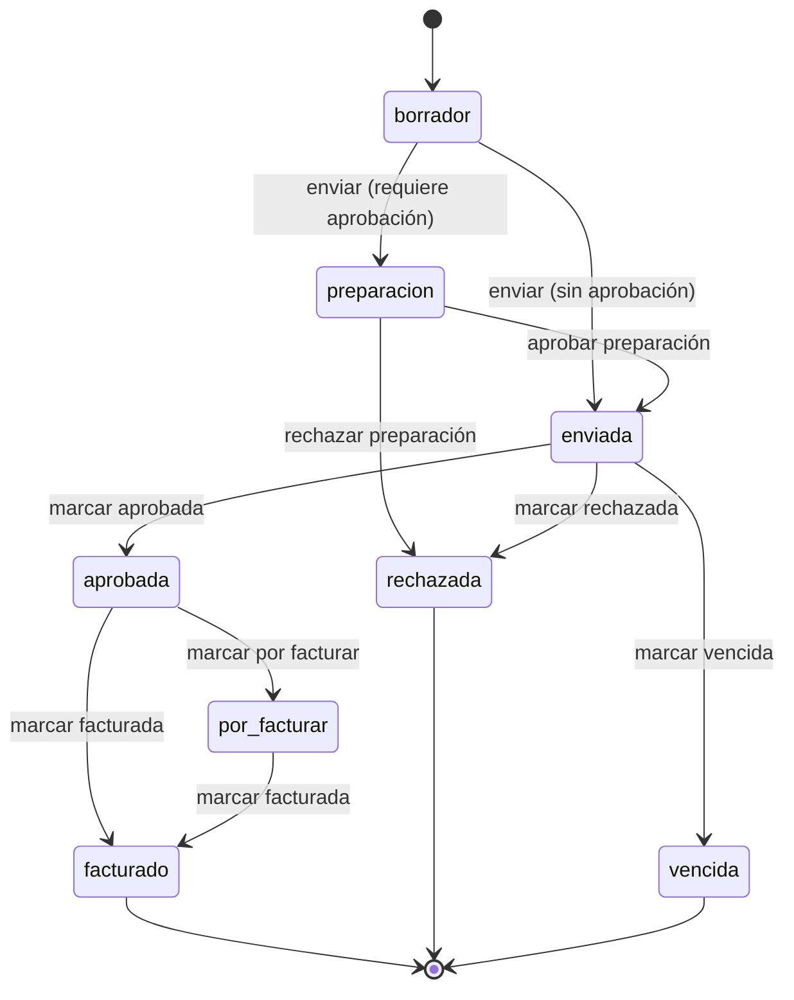

# Cotizaciones y motor de márgenes

> Revisado contra el código el 13/10/2026.

Una **cotización** es la propuesta económica de una oportunidad: una lista de líneas, cada una con su precio. Una
oportunidad puede tener varias cotizaciones y cada cotización puede tener varias versiones.

Esta página explica cómo se calcula el precio de cada línea, cuándo una cotización necesita aprobación antes de salir,
por qué estados pasa, quién mueve cada estado y qué ve el cliente en el PDF.

Todo el cálculo vive en el backend (`app/core/calculo.py` y `app/routers/cotizacion.py`). El frontend no recalcula
precios: muestra lo que devuelve `GET /cotizaciones/{id}`.

## Las líneas

Cada línea es un ítem que se le cobra al cliente. Hay dos ejes independientes: si viene del catálogo o es a medida, y
si se cotiza con proveedor o con precio directo.

| | Con proveedor externo | Precio directo (agencia) |
|---|---|---|
| **Servicio de catálogo** | Costo del proveedor + margen + comisión | Precio de catálogo del servicio, o un precio manual con motivo |
| **A medida** (`servicio_id` nulo) | Costo del proveedor + margen + comisión | Precio manual con motivo, obligatorio |

El constructor arma cada línea en 5 pasos: qué estás cotizando, clasificación comercial, modelo de cobro (precio
directo o con proveedor), montos y detalle, y revisión.

### Catálogo o a medida

- **Línea de catálogo.** Elige un servicio activo. El nombre, la descripción y la categoría salen del servicio. La
  categoría se hereda del servicio y no se edita en la línea: si alguien la manda en un `PATCH`, el backend responde
  422.
- **Línea a medida.** Para trabajo que no encaja en el catálogo. No obliga a crear un servicio nuevo solo para poder
  cotizarlo. Exige una descripción (de ahí sale el nombre en el PDF) y una **categoría comercial**: sin
  `categoria_servicio_id`, el `POST` devuelve 422. El selector precarga el interés comercial de la oportunidad, y se
  puede cambiar.

Si una línea no tiene categoría, la pantalla muestra **Sin categoría**.

**Por qué la categoría es obligatoria a medida.** Los reportes por categoría y pilar necesitan saber qué se vendió.
Una línea de catálogo ya lo sabe por su servicio; una a medida no tiene otra fuente que lo que elige el vendedor.

### Precio directo y precio manual

Sin proveedor, la línea no tiene margen ni comisión. El precio sale, en este orden:

1. `precio_venta_base_manual`, si el vendedor lo escribió. Exige `justificacion_precio` ("Motivo del precio").
2. El precio de catálogo del servicio (`precio_base_cliente`), o el monto del fee si el servicio es de fee.

El precio manual no pasa por aprobación: es una decisión explícita. El motivo queda como registro de por qué se
desvió del catálogo. Al enviar, si una línea de catálogo sin proveedor queda por debajo del mínimo que se cobró en cotizaciones
ganadas de los últimos 12 meses, la pantalla muestra un aviso. No bloquea el envío.

### Varios costos en una línea

Una línea con proveedor puede tener un desglose de costos: dos proveedores, transporte, etc.
(`/cotizaciones/{id}/lineas/{linea_id}/costos`). El costo de la línea es la suma del desglose. El desglose solo
aparece en el PDF interno; el cliente nunca lo ve.

### Borrador de líneas con IA

En una cotización en borrador, el vendedor puede describir en texto libre lo que pidió el cliente y pedir un
borrador de líneas (`POST /cotizaciones/{id}/sugerir-lineas`). La IA propone de 1 a 6 líneas usando solo servicios
reales del catálogo. Si devuelve un id que no existe, el backend lo descarta. No se crea nada: el vendedor revisa y
agrega cada línea a mano.

## El motor de márgenes

Una línea con proveedor se calcula en tres capas, más el impuesto:

| Capa | Fórmula | De dónde sale el % |
|---|---|---|
| Precio de venta base | `costo × (1 + margen/100)` | Margen del servicio; si no tiene, el margen de agencia de Configuración (30% por defecto) |
| Subtotal con comisión | `precio_venta_base × (1 + comisión/100)` | Comisión mínima sugerida del servicio; si no tiene, la comisión mínima de agencia (13% por defecto). El vendedor la negocia |
| Total de la línea | `subtotal × (1 + tasa/100)` | Tasa de impuesto de Configuración |

Cada capa multiplica a la anterior. La comisión se calcula **sobre el precio de venta base**, no sobre el costo crudo.

El margen y la comisión se resuelven al crear la línea, si el vendedor no los escribe. Después quedan guardados en la
línea: cambiar el default en Configuración no reescribe líneas existentes.

### Ejemplo

Una línea de producción con un costo de proveedor de 1.000, margen 30%, comisión 15% y una tasa de impuesto de 15%
(la tasa del ejemplo es ilustrativa; la real es la que esté cargada en Configuración):

| Paso | Cálculo | Resultado |
|---|---|---|
| Costo del proveedor | | 1.000,00 |
| Precio de venta base | 1.000 × 1,30 | 1.300,00 |
| Subtotal con comisión | 1.300 × 1,15 | **1.495,00** |
| Total de la línea | 1.495 × 1,15 | 1.719,25 |

Con cantidad 2, el subtotal extendido es 2.990,00 y el total extendido 3.438,50.

En pantalla el vendedor ve **1.495,00** por unidad: el monto sin IVA.

### Montos sin IVA en pantalla

Toda la UI del CRM muestra montos **sin IVA**, derivados de `subtotal_con_comision × cantidad`
(`src/lib/cotizacion-montos-ui.ts`). Nunca de `total_linea` ni de `total_linea_extendido`, que incluyen impuesto. La
lista de cotizaciones muestra `subtotal_cotizacion`.

El IVA solo aparece en el PDF, en el bloque de totales: Subtotal, IVA y Total.

**Por qué.** El IVA no es ingreso de la agencia: se cobra y se paga al Estado. Mezclarlo en pantalla infla el valor
de los negocios y hace incomparables los números del dashboard. El valor cotizado de la oportunidad también se guarda
sin IVA (ver [Pipeline](./02-pipeline.md)).

## Impuestos parametrizados

La tasa de impuesto nunca está escrita en el código. Vive en `configuracion_general.tasa_impuesto_pct` y se edita en
Configuración → Márgenes e impuestos.

- La configuración general no existe hasta que un admin la crea, y la tasa es obligatoria al crearla. Sin ella, el
  backend no puede calcular una cotización y responde 422.
- Mientras la cotización está en borrador o preparación, el total se calcula en vivo con la tasa vigente.
- Al pasar a **enviada**, la tasa se congela en `tasa_impuesto_pct_aplicada`. También se congela el precio de catálogo
  de las líneas sin proveedor y se fija la fecha de validez: hoy + `dias_validez_cotizacion` (30 por defecto).

**Por qué congelar.** Una cotización enviada es un documento que el cliente ya tiene. Si la tasa o un precio de
catálogo cambian después, la cotización enviada no puede cambiar de monto por detrás.

## Cuándo una cotización necesita aprobación

Al enviar, el backend revisa cada línea con proveedor. Hay un solo flujo de aprobación, pero dos condiciones
independientes que lo disparan. Basta con que una línea cumpla una de las dos.

| Regla | Aplica a | Se dispara si |
|---|---|---|
| **(A) Descuento** | Toda línea con proveedor | El total real de la línea cae más del umbral (10% por defecto) por debajo del total que daría con el margen y la comisión de política |
| **(B) Comisión reducida en fee** | Líneas con proveedor de un servicio de catálogo `fee_fijo` o `fee_recurrente` | La comisión de la línea es menor que la comisión mínima de política, sin importar el descuento total |

"De política" significa el margen y la comisión mínima que el sistema habría resuelto solo: los del servicio, o los
de agencia si el servicio no los define. El umbral es `umbral_descuento_aprobacion_pct` de Configuración.

Las líneas sin proveedor (precio directo o manual) no disparan ninguna de las dos reglas: no tienen margen ni comisión
que descontar.

Si alguna regla se cumple, la cotización pasa a **preparación** con `requiere_aprobacion = true` y espera a un
supervisor o admin. Si no, pasa directo a **enviada**.

### Ejemplo de la regla (A)

Política: margen 30%, comisión 13%. Costo 1.000. El impuesto se cancela en la comparación, así que se puede omitir.

| Escenario | Subtotal | Descuento frente a política | ¿Aprobación? |
|---|---|---|---|
| Política: 30% / 13% | 1.000 × 1,30 × 1,13 = 1.469,00 | | |
| Vendedor baja el margen a 20% | 1.000 × 1,20 × 1,13 = 1.356,00 | 7,7% | No |
| Vendedor baja el margen a 15% | 1.000 × 1,15 × 1,13 = 1.299,50 | 11,5% | Sí |

### Ejemplo de la regla (B) y por qué existe

Un servicio de fee recurrente, margen 30%, comisión de política 13%. El vendedor baja la comisión a 8%:

- Política: 1.000 × 1,30 × 1,13 = 1.469,00
- Real: 1.000 × 1,30 × 1,08 = 1.404,00
- Descuento: 4,4%. La regla (A) no lo atrapa.

La regla (B) sí: 8% es menor que el mínimo de 13%.

La comisión es una capa chica frente al margen. Bajarla a casi la mitad mueve el total menos de 5%, así que la regla
del descuento sola nunca la detectaría. En un fee recurrente esa diferencia se repite cada mes del contrato, por eso
tiene su propia regla.

### Aviso antes de enviar

Mientras armas la cotización, el constructor consulta `GET /cotizaciones/{id}/preview-aprobacion` y muestra un badge:
**Pedirá aprobación al enviar** o **Sin aprobación por descuento**. Es la misma regla que corre al enviar. No bloquea
nada: es para que el vendedor sepa antes de enviar.

## Estados de una cotización

| Estado | Qué significa |
|---|---|
| `borrador` | En armado. Es el único estado donde se agregan, editan o borran líneas y costos |
| `preparacion` | Enviada por el vendedor, pero cae en la regla (A) o (B). Espera aprobación interna |
| `enviada` | Salió al cliente. Tasa, precios y validez congelados |
| `aprobada` | El cliente aceptó |
| `por_facturar` | El cliente aceptó, pero todavía no se puede facturar (orden de compra pendiente o ya pasó el corte de facturación del mes) |
| `facturado` | Facturada. Guarda el número de factura, obligatorio |
| `rechazada` | La rechazó el cliente, o la rechazó un supervisor o admin en preparación |
| `vencida` | Pasó su validez sin respuesta |

Una cotización **ganada** es la que está en `aprobada`, `por_facturar` o `facturado`
(`app/core/estados_cotizacion.py`). Facturar no le quita la condición de ganada.

### Quién puede mover cada estado

| Acción | Endpoint | Desde | Quién |
|---|---|---|---|
| Enviar | `POST /cotizaciones/{id}/enviar` | `borrador` | Dueño de la oportunidad, supervisor o admin |
| Aprobar preparación | `POST /cotizaciones/{id}/aprobar-preparacion` | `preparacion` | Supervisor o admin |
| Rechazar preparación | `POST /cotizaciones/{id}/rechazar-preparacion` | `preparacion` | Supervisor o admin |
| Marcar aprobada | `POST /cotizaciones/{id}/marcar-aprobada` | `enviada` | Dueño, supervisor o admin |
| Marcar rechazada | `POST /cotizaciones/{id}/marcar-rechazada` | `enviada` | Dueño, supervisor o admin |
| Marcar vencida | `POST /cotizaciones/{id}/marcar-vencida` | `enviada` | Dueño, supervisor o admin |
| Marcar por facturar | `POST /cotizaciones/{id}/marcar-por-facturar` | `aprobada` | Dueño, supervisor o admin |
| Marcar facturada | `POST /cotizaciones/{id}/marcar-facturada` | `aprobada` o `por_facturar` | Dueño, supervisor o admin. Pide número de factura |

El frontend oculta los botones que tu rol no puede usar (`src/lib/cotizacion-transiciones.ts`) y, si no hay ninguno,
explica por qué. Pero la UI no es la barrera: el backend vuelve a verificar rol, dueño y estado en cada endpoint.

`vencida` se marca a mano. No hay un proceso que venza cotizaciones solas al pasar la fecha.

### Qué pasa en cada transición

- **Enviar.** Revisa que haya al menos una línea, que exista la configuración general y, si aplica, que haya un
  Documento de Alcance aprobado (ver [Documento de alcance](./04-documento-alcance.md)). Si va directo a enviada,
  congela tasa, precios y validez, y copia el subtotal a `valor_cotizado` de la oportunidad.
- **Aprobar preparación.** Congela igual que un envío directo, guarda quién aprobó en `aprobado_por` y pasa a
  enviada.
- **Marcar aprobada.** Copia el subtotal a la oportunidad, **la pasa a Cierre Ganado** (si no lo estaba) y dispara el
  evento `cotizacion.aprobada` hacia BackIO y cualquier otro destino suscrito (ver
  [Integraciones](./11-integraciones.md)). Si la oportunidad está en Cierre Perdido o desactivada, responde 409 y no
  aprueba nada. Ver [Pipeline y oportunidades](./02-pipeline.md).
- **Marcar rechazada o vencida.** Si era esta cotización la que sostenía el valor cotizado de la oportunidad, lo
  borra.
- Todas quedan en la bitácora de auditoría.

### Dos clics al mismo tiempo: 409

Cada transición es atómica (`app/core/transiciones.py`): el `UPDATE` solo se aplica si el estado sigue siendo el
esperado. Si dos personas, o un doble clic, intentan mover la misma cotización a la vez, solo una gana. La otra recibe
**409**: "El registro cambió de estado mientras lo procesabas".

El frontend muestra ese mensaje y recarga la cotización para que veas el estado real.

**Por qué importa.** Sin esto, dos "marcar aprobada" simultáneos dispararían dos veces el webhook y crearían dos
propuestas de proyecto en BackIO. Los efectos externos se ejecutan solo después de ganar la transición.

## Versiones y duplicados

Una cotización que ya salió no se edita. Para cambiarla se crea otra.

| Acción | Endpoint | Para qué | Resultado |
|---|---|---|---|
| Nueva versión | `POST /cotizaciones/{id}/nueva-version` | Corregir o renegociar la misma propuesta | Un borrador nuevo en la **misma oportunidad**, con versión +1 y las mismas líneas y costos |
| Duplicar / partir de una plantilla | `POST /cotizaciones/{id}/duplicar` | Usar una cotización como plantilla para otro cliente | Un borrador nuevo e independiente (versión 1) en **otra oportunidad** que eliges |

- Nueva versión no aplica a una cotización en borrador o preparación: esas se editan directo (409).
- Las versiones de una cadena se listan en `GET /cotizaciones/{id}/versiones`.
- La oportunidad destino tiene que ser tuya (o del equipo, si eres supervisor o admin).
- El origen puede ser **una cotización ganada de cualquier vendedor** (desde el 14/10/2026). En la oportunidad, el
  botón «Partir de una plantilla» lista las ganadas de toda la organización (`GET /cotizaciones/plantillas`) con lo
  mínimo para reconocerlas: número, empresa, oportunidad, servicios, subtotal sin IVA y fecha. Nunca costos, márgenes
  ni comisiones.
- Si la plantilla es de **otro vendedor**, la copia lleva servicios, descripciones, cantidades y precios manuales, pero
  **no** costos, proveedores, margen ni comisión: la comisión es una condición negociada por persona. Esos campos
  quedan para completar o se resuelven por política. Si la plantilla es tuya, se copia todo.
- Una cotización que no está ganada solo se puede duplicar si es tuya.
- En ambos casos el precio de catálogo no se copia congelado: se vuelve a resolver en vivo, como en cualquier
  borrador.

Cada cotización tiene su propio número (`COT-000123`), generado por una secuencia de Postgres. Nunca por conteo: dos
cotizaciones creadas al mismo tiempo podrían calcular el mismo número.

## PDF interno y PDF de cliente

El PDF se genera en el backend con una sola plantilla (`app/templates/cotizacion.html`) y un indicador `interno`.

| | PDF de cliente | PDF interno |
|---|---|---|
| Endpoint | `GET /cotizaciones/{id}/pdf-cliente` | `GET /cotizaciones/{id}/pdf-interno` |
| Por línea | Servicio, detalle, cantidad, subtotal sin IVA | Además: proveedor, costo (o el desglose de costos), margen %, comisión %, precio de venta base y subtotal con comisión |
| Totales | Subtotal, IVA y Total | Igual |
| Quién | Dueño de la oportunidad, supervisor o admin | Igual. El botón "Ver PDF interno" solo aparece para ellos |

Los dos llevan el logo de la organización, datos del cliente y del ejecutivo, validez, condiciones comerciales (si están cargadas en
Configuración), firmas y un código QR de verificación.

**Por qué en el backend.** Elegir qué vista se renderiza es una decisión de permisos, no de presentación. Si el
frontend recibiera el desglose completo para decidir si mostrarlo, ocultarlo sería la única barrera. El servidor
decide qué plantilla renderiza según quién pide, reutilizando el mismo cálculo de `GET /cotizaciones/{id}`.

El PDF de cliente tiene un límite de frecuencia por usuario (20 por minuto).

### Verificación pública

El QR del PDF apunta a `GET /cotizaciones/{id}/verificar`, el único endpoint de cotizaciones sin sesión: el cliente lo
abre desde su teléfono. Devuelve solo número, estado, fecha y total. Nunca costos, margen ni datos del contacto o del
ejecutivo. Tiene límite de 30 consultas por minuto.

Por confirmar: el endpoint responde datos en JSON; el frontend no tiene una página de verificación propia.

## Endpoints

| Método | Ruta | Para qué |
|---|---|---|
| `GET` | `/cotizaciones` | Lista global con búsqueda, estado y rango de vencimiento |
| `POST` | `/cotizaciones` | Crear un borrador en una oportunidad |
| `GET` | `/cotizaciones/{id}` | Cotización con líneas calculadas |
| `POST`, `PATCH`, `DELETE` | `/cotizaciones/{id}/lineas[/{linea_id}]` | Líneas (solo en borrador) |
| `POST`, `PATCH`, `DELETE` | `/cotizaciones/{id}/lineas/{linea_id}/costos[/{costo_id}]` | Desglose de costos (solo en borrador) |
| `GET` | `/cotizaciones/{id}/preview-aprobacion` | ¿Pedirá aprobación al enviar? |
| `POST` | `/cotizaciones/{id}/sugerir-lineas` | Borrador de líneas con IA |
| `POST` | `/cotizaciones/{id}/nueva-version`, `/duplicar` | Versiones y plantillas |
| `POST` | `/cotizaciones/{id}/enviar`, `/aprobar-preparacion`, … | Transiciones de estado (tabla de arriba) |
| `GET` | `/cotizaciones/{id}/pdf-cliente`, `/pdf-interno` | PDFs |
| `GET` | `/cotizaciones/{id}/verificar` | Verificación pública del QR |

Las cotizaciones mensuales de un contrato de fee se generan aparte y tienen su propia lógica. Ver
[Contratos de fee y facturación](./05-contratos-facturacion.md).
