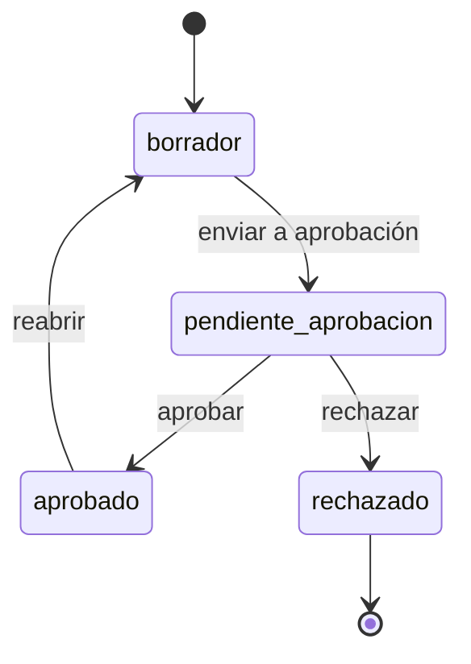

# Documento de alcance

> Revisado contra el código el 13/10/2026.

El **Documento de Alcance** dice qué se va a hacer para el cliente: objetivo, qué incluye y qué no, metodología,
tiempos, entregables y condiciones. La cotización dice cuánto cuesta; el documento de alcance dice qué compra el
cliente por ese precio.

Cada documento cuelga de una **cotización**. Una cotización puede tener varios documentos y cada documento puede
tener varias versiones.

## Cuándo es obligatorio

El documento solo bloquea el envío de una cotización cuando se cumplen dos condiciones a la vez:

1. El interruptor de la organización `configuracion_general.requiere_documento_alcance` está encendido. Por defecto
   está apagado.
2. Al menos una línea de la cotización usa un servicio de catálogo marcado con **Requiere Documento de Alcance**
   (paso 7 del wizard de servicio, ver [Servicios y configuración](./09-servicios-configuracion.md)).

Si las dos se cumplen, `POST /cotizaciones/{id}/enviar` exige al menos un documento **aprobado** para esa
cotización. Si no lo hay, responde 422: "falta al menos un Documento de Alcance aprobado". Las líneas a medida no
activan el requisito.

El backend evalúa las dos condiciones en vivo al enviar. La cotización tiene un campo `requiere_documento_alcance`
que el constructor usa para mostrar el aviso **Alcance requerido** o **Alcance aprobado**, pero es informativo: el
envío nunca confía en él, porque un servicio se puede marcar después de armar la cotización.

**Por qué un interruptor general.** Es un apagado de emergencia. Con el interruptor en falso, ningún servicio
marcado bloquea nada, y toda cotización se comporta como antes de existir esta regla.

Por confirmar: no hay un control en la pantalla de Configuración para encender el interruptor; hoy se cambia por API
(`PATCH /config/general`).

## El wizard

El documento se arma en un wizard dentro de la cotización. Arranca con dos caminos:

- **Generar con IA.** El backend escribe un primer borrador en segundo plano a partir de las líneas de la
  cotización. La pantalla muestra el progreso mientras tanto.
- **Empezar en blanco.** Crea el documento vacío, sin IA (`generar_ia=false`).

Después, los pasos:

| Paso | Título en pantalla | Secciones |
|---|---|---|
| 1. Objetivo | ¿Qué quiere lograr el cliente? | Objetivo |
| 2. Alcance | ¿Qué incluye el proyecto? | Alcance funcional, alcance técnico incluido, no incluido, metodología |
| 3. Entregables | ¿Qué entregamos y en qué plazos? | Entregables, tiempos, supuestos, modelo de inversión |
| 4. Condiciones (opcional) | Condiciones y textos de agencia | Condiciones de pago, exclusiones, consideraciones, por qué Geeks |
| 5. Revisión IA | Revisión con el auditor de IA | Advertencias del auditor |
| 6. Word y envío | Word y envío a aprobación | Descargar y subir Word, enviar a aprobación |

El paso de condiciones se puede omitir: si no lo tocas, el documento usa los textos por defecto de la agencia.

En cada paso hay un **copiloto**: le pides una propuesta para la sección en la que estás, con una instrucción
opcional (`POST /documentos-alcance/{id}/regenerar-seccion`). Devuelve una propuesta y no guarda nada. Si la aceptas,
se guarda como cualquier edición.

## Dos capas de contenido

| Capa | Secciones | De dónde sale |
|---|---|---|
| **Capa 1** (contenido del proyecto) | Objetivo, alcance funcional, alcance técnico incluido y no incluido, metodología, tiempos, modelo de inversión, supuestos, entregables | La IA en el primer borrador, el copiloto o el vendedor |
| **Capa 2** (textos de agencia) | Condiciones de pago, exclusiones, consideraciones, por qué Geeks | Defaults de la agencia, que el documento puede pisar |

- **Condiciones de pago** se resuelven sin IA, según el modelo de cobro de los servicios cotizados: un texto para
  pago único (`por_hora`, `fee_fijo`), otro para recurrente (`fee_recurrente`), y los dos juntos si la cotización
  mezcla ambos. Nunca se elige uno "por mayoría": eso ocultaría condiciones reales al cliente.
- **Exclusiones, consideraciones y por qué Geeks** usan el texto por defecto de `configuracion_general` mientras el
  documento no tenga uno propio.

## Qué hace la IA y qué no

La generación (`app/core/documento_alcance_ia.py`) recibe solo datos de catálogo y la cantidad de cada línea: nombre,
categoría, descripción del servicio, nota de la línea y modelo de cobro. **No recibe precios**: costo, margen,
comisión y montos ni siquiera se leen al armar el pedido a la IA.

Reglas que se le dan:

- No mencionar montos, precios, tarifas ni cifras.
- No inventar servicios, entregables ni tecnologías que no estén cotizados.
- El modelo de inversión se describe en palabras ("fee recurrente, ciclo mensual"), nunca con cifras.

Si la generación falla, el documento queda con un mensaje genérico y puedes **reintentar** o seguir en blanco.
Reintentar reutiliza el mismo documento si sigue vacío. El detalle técnico del error va al log del servidor, nunca a
la pantalla.

**Por qué la IA no ve precios.** El documento es para el cliente. Si la IA no recibe montos, no hay forma de que un
costo interno termine escrito en el alcance por error.

### El auditor de IA

En el paso de revisión, el auditor (`POST /documentos-alcance/{id}/auditar`) compara el documento con lo cotizado y
devuelve advertencias de severidad alta, media o baja. Busca, por ejemplo, algo prometido que ningún servicio cubre,
un servicio cotizado que no aparece, o un modelo de facturación que no coincide.

- Cada advertencia trae una cita del documento. El backend verifica que la cita exista de verdad en el texto; si la
  IA la inventó o la parafraseó, la advertencia lo indica.
- El auditor es **solo informativo**: nunca bloquea el envío ni la aprobación. La IA puede equivocarse y el
  supervisor decide.
- Si editas el documento después de auditarlo, la auditoría se borra: describía un contenido que ya no existe.

## Estados y aprobación

| Acción | Endpoint | Desde | Quién |
|---|---|---|---|
| Editar | `PATCH /documentos-alcance/{id}` | `borrador` o `rechazado` | Quien tenga acceso a la cotización |
| Enviar a aprobación | `POST /documentos-alcance/{id}/enviar-aprobacion` | `borrador`, sin generación en curso | Quien tenga acceso a la cotización |
| Aprobar | `POST /documentos-alcance/{id}/aprobar` | `pendiente_aprobacion` | Supervisor o admin |
| Rechazar | `POST /documentos-alcance/{id}/rechazar` | `pendiente_aprobacion` | Supervisor o admin |
| Reabrir | `POST /documentos-alcance/{id}/reabrir` | `aprobado` | Quien tenga acceso a la cotización |

"Quien tenga acceso" sigue la regla de siempre: el dueño de la oportunidad, un supervisor o un admin. Ver
[Roles y permisos](./01-roles-permisos.md).

Las transiciones son atómicas, igual que en cotizaciones: si dos personas actúan a la vez, una recibe **409** y la
pantalla recarga el estado real.

Un documento rechazado se puede editar, pero no se reenvía a aprobación: el envío solo sale de `borrador`. Para seguir
se crea una **nueva versión** (ver abajo) o un documento nuevo.

**Solo uno sin resolver a la vez.** Una cotización no puede tener dos documentos raíz en `borrador` o
`pendiente_aprobacion` al mismo tiempo: crear otro devuelve 409. Así nunca hay duda de cuál es el vigente.

### Reabrir

Un documento aprobado no se edita directo. Para cambiarlo hay que **reabrir**: vuelve a borrador, pierde la
aprobación y se borra su PDF. Después hay que enviarlo y aprobarlo otra vez.

**Por qué es una acción explícita.** Cualquier cambio después de aprobado invalida la aprobación. Si una edición la
anulara en silencio, nadie sabría que el documento que el cliente tiene ya no es el aprobado.

## PDF y Word

| | PDF | Word (.docx) |
|---|---|---|
| Cuándo existe | Solo aprobado | En cualquier estado |
| Cómo se genera | Una sola vez, al aprobar | Al vuelo, con el contenido actual |
| Endpoint | `GET /documentos-alcance/{id}/pdf` | `GET /documentos-alcance/{id}/docx` |
| Para qué | El documento final para el cliente | Editar fuera de prometIO |

- El PDF se guarda en un bucket privado y lo sirve el backend. Si el documento no está aprobado, responde 409.
- El Word lleva carátula con cliente, número de cotización, versión, fecha, ejecutivo, logo y colores de la marca.
- Los textos de capa 2 sin texto propio salen con el default de la agencia, tal como los ve el cliente.

### Subir un Word editado

Puedes descargar el Word, editarlo y subirlo de vuelta (`POST /documentos-alcance/{id}/subir-docx`, hasta 10 MB). El
backend:

1. Reconoce las secciones por sus títulos. Hay que editar el Word descargado desde prometIO sin cambiar los títulos.
2. Crea una **versión nueva** con el contenido leído. Una sección cuyo título no encuentra conserva su valor anterior:
   no se interpreta como borrada.
3. Adjunta un resumen de cambios hecho con IA. La lista de secciones cambiadas es determinística; la IA solo la
   redacta. Si la IA falla, la versión se crea igual con la lista simple.
4. Guarda el archivo original.

Si un texto de capa 2 quedó igual al default de la agencia, se guarda sin texto propio, para que siga vinculado al
default.

## Versiones

| Acción | Endpoint | Qué hace |
|---|---|---|
| Nueva versión | `POST /documentos-alcance/{id}/nueva-version` | Copia el contenido de la versión actual a un borrador nuevo, con versión +1. No vuelve a generar con IA |
| Subir Word | `POST /documentos-alcance/{id}/subir-docx` | Crea una versión nueva con el contenido del Word |
| Listar | `GET /documentos-alcance/{id}/versiones` | La cadena de versiones con su estado |

Todas las versiones de un documento comparten la misma raíz (`documento_raiz_id`). Para el requisito de envío de la
cotización basta con que cualquier documento de esa cotización esté aprobado.

## Endpoints

| Método | Ruta | Para qué |
|---|---|---|
| `POST` | `/cotizaciones/{id}/documentos-alcance` | Crear (con IA por defecto, o vacío con `generar_ia=false`). Límite de frecuencia de IA |
| `GET` | `/cotizaciones/{id}/documentos-alcance` | Documentos de una cotización |
| `GET`, `PATCH` | `/documentos-alcance/{id}` | Leer y editar |
| `POST` | `/documentos-alcance/{id}/enviar-aprobacion`, `/aprobar`, `/rechazar`, `/reabrir` | Estados |
| `POST` | `/documentos-alcance/{id}/nueva-version`, `/subir-docx` | Versiones |
| `POST` | `/documentos-alcance/{id}/auditar`, `/regenerar-seccion` | Auditor y copiloto de IA. Límite de frecuencia de IA |
| `GET` | `/documentos-alcance/{id}/pdf`, `/docx` | Archivos |
