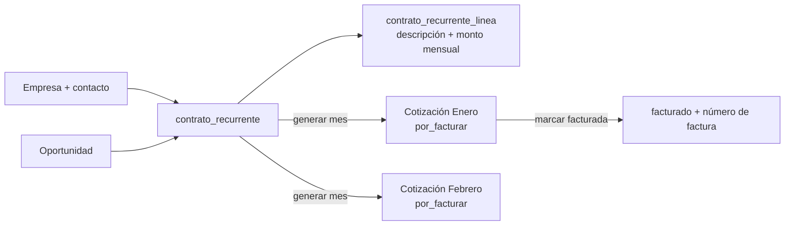
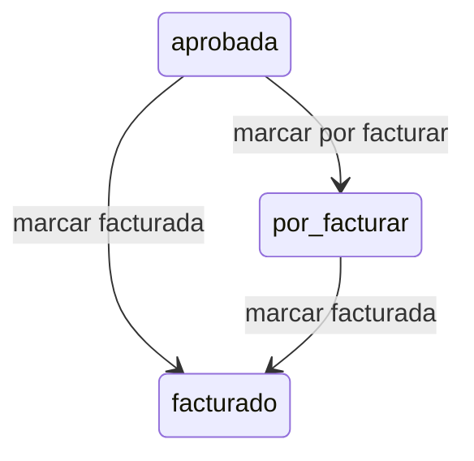

# 05 · Contratos de fee recurrente y facturación

> Revisado contra el código el 13/10/2026.

Buena parte de lo que factura Geeks no es una cotización suelta: es un fee mensual que el cliente
paga mientras dure un contrato. Antes eso vivía fuera del CRM y cada mes alguien armaba la
cotización a mano. Esta parte de prometIO resuelve tres cosas:

1. Registrar el contrato una vez (cliente, vigencia, líneas y monto mensual).
2. Crear la cotización de cada mes sin trabajo manual y sin duplicados.
3. Saber cuánto está ya contratado hacia adelante (el **piso de facturación**) y qué contratos
   hay que renovar antes de que se caigan.

Todos los montos de esta página son **sin IVA**.

## Dónde vive

| Pantalla | Ruta | Qué muestra |
|---|---|---|
| Contratos | `/contratos` | Lista de contratos con vigencia, fecha de fin y subtotal mensual. Filtros: búsqueda (contrato o empresa), vigencia y activos/desactivados |
| Ficha del contrato | `/contratos/{id}` | Subtotal mensual, vigencia, días para renovar, líneas, meses generados y notas |
| Renovaciones | `/contratos/renovaciones` | Contratos que vencen dentro de una ventana, o que ya vencieron sin renovar |
| Proyección | `/contratos/proyeccion` | Piso contratado mes a mes, con lo facturado y lo pendiente |
| Facturas | `/facturas` | Facturas emitidas en Contífico (solo lectura) |

Los contratos usan los permisos del módulo de Ventas: `administrativo` y `ventas`. Un vendedor ve y
edita solo los contratos cuya oportunidad es suya. Ver [Roles y permisos](./01-roles-permisos.md).

## Modelo

Un contrato no tiene tabla de "periodos". **Los meses del contrato son sus cotizaciones**: cada
cotización generada lleva `contrato_recurrente_id` y `periodo_contrato` (el día 1 del mes). Así el
mes de un fee pasa por el mismo flujo de facturación que cualquier otra cotización.



Tablas: `contrato_recurrente` y `contrato_recurrente_linea` (migración `0090_contrato_recurrente.sql`).

## Alta de un contrato

Desde **Nuevo contrato** se carga:

| Campo | Regla |
|---|---|
| Empresa y contacto | Obligatorios |
| Oportunidad | Una oportunidad existente de esa empresa, o **Crear una oportunidad ganada** |
| Nombre del contrato | Obligatorio (ej. "Fee de marketing digital 2027") |
| Inicio y fin | Obligatorias. El fin no puede ser anterior al inicio |
| Notas | Opcional |
| Líneas | Al menos una |

**Por qué se crea una oportunidad ganada.** Las cotizaciones de cada mes necesitan colgar de una
oportunidad. Si el contrato no viene de una oportunidad del pipeline, el backend crea una en
`cierre_ganado`, a nombre de quien carga el contrato, con `valor_referencial` igual a:

```
valor_referencial = Σ monto_mensual de las líneas × meses del contrato (inicio y fin incluidos)
```

Un contrato firmado ya es un negocio ganado: no tiene sentido hacerlo recorrer el pipeline. Si la
oportunidad elegida no es de la misma empresa, el alta se rechaza con 422.

### Líneas

Cada línea es lo que entra en la cotización de cada mes:

| Campo | Regla |
|---|---|
| Servicio | Del catálogo, opcional |
| Categoría | Obligatoria si no hay servicio (mismo criterio que una línea a medida de cotización, ver [Cotizaciones](./03-cotizaciones.md)) |
| Descripción | Obligatoria, no puede quedar vacía |
| Subtotal mensual | Mayor que 0 |

El subtotal mensual del contrato es la suma de sus líneas.

**Editar líneas** reemplaza todas las líneas del contrato y **solo afecta a los meses que todavía no
se generaron**. Las cotizaciones ya creadas conservan el monto con el que nacieron. El backend
inserta las líneas nuevas antes de borrar las viejas, para que el contrato nunca quede sin líneas si
algo falla a mitad.

## Vigencia

La vigencia no se guarda: se calcula cada vez, con la fecha de hoy en hora de Ecuador.

| Vigencia | Condición | Badge |
|---|---|---|
| Por iniciar | hoy < `fecha_inicio` | outline |
| Vigente | entre inicio y fin, y faltan más días que el aviso | success |
| Por renovar | entre inicio y fin, y faltan **≤ días de aviso** para `fecha_fin` | warning |
| Vencido | hoy > `fecha_fin` | destructive |

`dias_para_vencer = fecha_fin − hoy` (negativo si ya venció).

**Aviso de renovación.** Los días de aviso salen de `configuracion_general.contrato_dias_aviso_renovacion`
(30 por defecto). Se cambia en Configuración → **Parámetros generales** (solo admin).

En la lista, el filtro **Vigentes** muestra los contratos en `vigente` o `por_renovar`; **No vigentes**,
los demás.

## Renovaciones

La pestaña Renovaciones lista los contratos **activos** cuya `fecha_fin` cae entre:

- **90 días atrás** (los vencidos sin renovar siguen apareciendo tres meses: es el caso más urgente), y
- **hoy + ventana**. La ventana por defecto es el aviso configurado; se puede ampliar a 30, 60, 90
  o 180 días.

Cada fila muestra el subtotal mensual en juego. El mismo listado, con el aviso configurado, alimenta
el bloque "Renovaciones próximas" del [Dashboard](./06-dashboard.md).

### Renovar

**Renovar** (en la ficha, solo para contratos activos) pide una nueva fecha de fin, que tiene que ser
posterior a la actual. Opcionalmente, con "Cambiar líneas o montos al renovar", reemplaza las líneas
(por ejemplo, un nuevo precio). La auditoría guarda la fecha de fin y el monto mensual anteriores y
nuevos.

Renovar extiende el mismo contrato: no crea uno nuevo ni otra oportunidad.

### Desactivar y reactivar

Solo `administrativo` o supervisor de ventas. Un contrato desactivado:

- no genera más meses,
- no cuenta en la proyección ni en renovaciones,
- conserva sus cotizaciones ya generadas.

Reactivar lo devuelve a todo lo anterior. Desactivar uno ya inactivo (o al revés) responde 409.

## Generar el mes

`POST /contratos-recurrentes/generar-mes` crea la cotización del mes de cada contrato activo que
esté vigente en algún día de ese mes.

Cada cotización generada:

- tiene una línea por línea del contrato, cantidad 1, con precio manual igual al monto mensual y el
  mes agregado al título de la línea ("Gestión de redes — Marzo 2027");
- no requiere documento de alcance;
- nace directo en **`por_facturar`**.

**Por qué nace en `por_facturar`.** El contrato ya es la aprobación del cliente: no hay nada que
enviar ni aprobar. Por la misma razón, no pasa por "marcar aprobada", así que **no dispara el webhook
`cotizacion.aprobada` hacia BackIO** (crearía un borrador de proyecto cada mes) y no pisa el
`valor_cotizado` de la oportunidad. Como el precio es manual y sin proveedor, tampoco entra en las
reglas de aprobación por descuento.

**Idempotente.** Si el contrato ya tiene cotización para ese mes, se cuenta como "ya existía" y no se
duplica. Un índice único en la base (`contrato_recurrente_id` + `periodo_contrato`) lo garantiza
incluso si el cron y el botón corren al mismo tiempo. Si la creación falla a mitad, la cotización
incompleta se borra para no bloquear ese mes.

El resultado trae tres números: **Generadas**, **Ya existían** y **Errores** (con el contrato y el
motivo; por ejemplo, un contrato sin líneas).

### Dos formas de dispararlo

| Vía | Quién | Alcance |
|---|---|---|
| Botón **Generar mes** en Contratos | En la UI, `administrativo` y supervisor de ventas. Se elige el mes | Todos los contratos que la sesión puede ver |
| Cron externo | GitHub Actions del repo backend, el día 1 de cada mes a las 06:00 (hora Ecuador). Se puede correr a mano con un periodo para recuperar un mes atrasado | Todos los contratos |

El backend no tiene scheduler propio. El cron llama al endpoint con el header `X-Cron-Secret`, que se
compara contra la variable `CRON_SECRET` del backend. El mismo valor tiene que estar como secreto del
repositorio en GitHub; si se rota uno, hay que rotar el otro. Sin `CRON_SECRET` configurado, la vía
cron responde 403 y solo queda el botón. Si algún contrato falla, el job queda en rojo y GitHub avisa.

Sin periodo, se genera el mes en curso en hora de Ecuador.

## Proyección

`/contratos/proyeccion` muestra, mes a mes, cuánto ya está contratado. Por defecto: 3 meses atrás y 12
hacia adelante (configurable: 6 a 24 adelante; 3, 6 o 12 atrás).

Para cada mes, sobre los contratos **activos** vigentes en algún día del mes:

| Columna | Cálculo |
|---|---|
| **Piso contratado** | Σ por contrato: si el mes ya tiene cotización en `por_facturar` o `facturado`, su subtotal real; si no, el monto mensual actual del contrato |
| **Por facturar** | Parte del piso con cotización del mes en `por_facturar` |
| **Facturado** | Parte del piso con cotización del mes en `facturado` |
| **Vence en el mes** | Σ monto mensual de los contratos cuya `fecha_fin` cae en ese mes: lo que se cae el mes siguiente si no se renueva |
| **Facturado agencia (Contífico)** | Opcional, ver abajo |

Siempre se cumple `por_facturar + facturado ≤ piso_contratado`. La diferencia son los meses que
todavía no se generaron.

**Comparar con Contífico.** Con la casilla "Comparar con lo facturado en Contífico", para cada mes ya
iniciado se suma todo lo facturado por la agencia según Contífico: facturas no anuladas, sin IVA,
excluyendo los clientes de medios. Es lento porque consulta Contífico mes a mes, por eso es opcional.
Esta columna incluye **todo** lo facturado, no solo fees: sirve para ver qué parte de la facturación
real ya está cubierta por contratos.

## Estados de facturación de una cotización

Además de los estados de envío (ver [Cotizaciones](./03-cotizaciones.md)), una cotización aceptada pasa
por dos estados de facturación (migración `0089_cotizacion_estados_facturacion.sql`):



| Estado | Cuándo |
|---|---|
| `por_facturar` | El cliente aceptó, pero todavía no se puede facturar (orden de compra pendiente, o ya pasó el corte de facturación del cliente). Las cotizaciones de contrato nacen acá |
| `facturado` | Ya se emitió la factura. Guarda `numero_factura`, que es **obligatorio** al marcarla |

`aprobada`, `por_facturar` y `facturado` cuentan igual como cotización **ganada** en todo el sistema.

En la ficha del contrato, cada mes en `aprobada` o `por_facturar` tiene el botón **Marcar facturada**;
los ya facturados muestran su número de factura. Clic en la fila abre la cotización.

Marcar facturada en prometIO es un registro manual: no emite nada en Contífico. La emisión
electrónica desde prometIO sigue diferida.

## Facturas (Contífico)

`/facturas` lee las facturas electrónicas (`FAC`) emitidas en Contífico. Es **solo lectura**.

### Resumen

Para el periodo elegido (un mes, una ventana de últimos meses o un rango), con montos sin IVA y sin
las facturas anuladas:

| Indicador | Cálculo |
|---|---|
| Total facturado | Agencia + medios |
| Facturación agencia | Facturas a clientes que **no** están en Clientes de medios |
| Facturación medios | Facturas a clientes cuyo RUC está en Clientes de medios |
| Por categoría | Suma de líneas por categoría de producto de Contífico (`cantidad × precio × (1 − descuento)`), con su pilar si está mapeado |

El subtotal de cada factura es `subtotal_0 + subtotal_12` de Contífico (la base antes de impuestos).

### Agencia contra medios

Parte de lo que factura Geeks es pauta de medios que pasa a través de la agencia. Mezclarla con los
honorarios inflaría la facturación propia. Por eso existe la lista de **Clientes de medios**
(`cliente_medios`, por RUC): todo lo facturado a esos RUC cuenta como medios y queda fuera de
"agencia". Esa separación se usa también en la meta comercial del [Dashboard](./06-dashboard.md) y en
la proyección.

Solo `administrativo` puede agregar o quitar RUC de la lista, desde el botón **Clientes de medios** o
con **Marcar medios** en una fila de factura. Si la lista está vacía, la pantalla avisa que todo cuenta como agencia.

### Lista

Paginada de a 25, ordenable por fecha, valor o cliente, con filtro por nombre de cliente. Cada factura
trae enlaces al RIDE y al XML de Contífico.

Detalles de la integración (tope de páginas, deduplicación, qué pasa si Contífico falla) en
[Integraciones](./11-integraciones.md#contifico).
