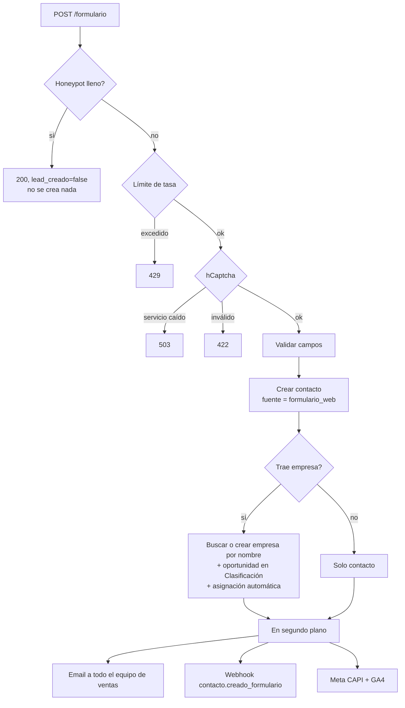

# 07 · Bandeja y formulario web

> Revisado contra el código el 13/10/2026.

Son las dos puertas de entrada de leads que no pasan por un vendedor: lo que escribe alguien por un
canal de mensajería (Bandeja) y lo que llena alguien en una landing (formulario web). Las dos terminan
en el mismo lugar: un **contacto**, y si hay empresa, una **oportunidad en Clasificación asignada
automáticamente**. Pero llegan ahí por caminos distintos, y la diferencia es a propósito:

| | Bandeja | Formulario web |
|---|---|---|
| ¿Crea contacto solo? | **No.** Solo cuando alguien pulsa "Convertir a contacto" | Sí, en cada envío válido |
| Por qué | Una conversación puede ser spam, un proveedor o alguien que pregunta la hora. Decidir si es un lead es trabajo humano | Quien llena un formulario comercial ya declaró interés y dejó sus datos |

## Bandeja

`/bandeja`. Pantalla del área de Ventas (`administrativo` y `ventas`).

### Estado actual

El backend de la bandeja está completo (conversaciones, mensajes, reclamar, reasignar, cerrar,
reabrir, convertir) y la pantalla existe. **La conexión con canales reales no está construida**: no hay
integración con Jelou/WhatsApp, Messenger, Instagram ni chat web en el código. Hoy un mensaje escrito
en la bandeja se guarda en prometIO, pero no se envía a ningún canal. Ver
[Integraciones](./11-integraciones.md#jelou-whatsapp-messenger-instagram).

### Canales

Una conversación tiene uno de estos canales: WhatsApp, Instagram, Messenger o Chat web. El canal se usa
para mostrar el origen y, al convertir, se guarda en el contacto como `canal_origen`.

### Quién ve qué

| Rol | Ve |
|---|---|
| `administrativo` y supervisor de ventas | Todas las conversaciones. Pueden alternar entre "Mías + sin asignar" y "Todo el equipo" |
| Vendedor (y marketing, si accede por API) | Las asignadas a sí mismo y las sin asignar |

Abrir una conversación asignada a otra persona responde 403.

### Acciones

| Acción | Quién | Regla |
|---|---|---|
| **Reclamar** | Cualquiera que la vea | Solo una conversación sin asignar. Si dos personas reclaman a la vez, la segunda recibe 409 ("ya fue reclamada") |
| **Reasignar** | `administrativo` y supervisor de ventas | El destino tiene que ser de `ventas` o `marketing` y estar activo. Queda en la auditoría con el asignado anterior y el nuevo |
| **Cerrar** / **Reabrir** | Quien la ve | Cerrar solo una abierta; reabrir solo una cerrada. Para escribir en una cerrada hay que reabrirla |
| **Enviar mensaje** | Quien la ve | Se guarda como mensaje del hilo |
| **Convertir a contacto** | Quien la ve | Ver abajo |

En móvil la bandeja es lista **o** hilo, nunca los dos a la vez.

### Convertir a contacto

**Una conversación no es un contacto hasta que alguien hace clic en "Convertir a contacto".** No hay
ninguna regla automática que lo haga, y no debe haberla: es la decisión que separa ruido de leads.

El diálogo ofrece dos caminos:

1. **Crear uno nuevo.** Nombre completo (por defecto, el nombre del remitente), teléfono móvil (en
   WhatsApp, por defecto el número del remitente) y email de trabajo. Si ya existe un contacto con ese
   teléfono, responde 409 y el diálogo ofrece vincular ese contacto en lugar de duplicarlo. El contacto
   nuevo queda con `fuente = bandeja`.
2. **Vincular a un contacto existente.** Búsqueda por nombre, email o teléfono (mínimo 2 caracteres).

**Empresa (opcional).** Si se elige una empresa, además se crea una oportunidad en **Clasificación**
asignada automáticamente a un vendedor (ver [Asignación automática](#asignacion-automatica)). Sin
empresa no se puede crear oportunidad, porque toda oportunidad necesita empresa; el contacto queda
creado igual.

Una conversación ya convertida no se puede convertir de nuevo (409). La conversión deja un evento
`lead_convertido` en el [Timeline](./10-agenda.md#timeline).

### SLA

**Por confirmar.** El modelo de datos tiene `conversacion.sla_limite`, pero hoy nada lo calcula ni lo
muestra en la bandeja.

## Asignación automática

Cuando la bandeja o el formulario crean una oportunidad, el vendedor sale de
`configuracion_general.metodo_asignacion_leads`:

| Método | Cómo elige |
|---|---|
| `round_robin` (por defecto) | El siguiente vendedor activo después del último asignado, en orden fijo, y vuelve a empezar |
| `carga_trabajo` | El vendedor activo con menos oportunidades abiertas y activas; si hay empate, round robin entre los empatados |
| `geografia` | El vendedor mapeado a la provincia del contacto en Asignación geográfica. Sin provincia, sin mapeo o con el vendedor inactivo, cae a round robin |

Solo entran perfiles de `ventas` con rol `vendedor` y activos. Si no hay ninguno, la asignación falla
con 422 (en el formulario, ese fallo no llega al visitante: el contacto se crea igual).

## Formulario web

Un widget que se pega en cualquier landing (de Geeks o de un cliente) y crea contactos en prometIO.
Se configura en **Configuración → Formulario web** (`/configuracion/formulario-web`), solo
`administrativo`, en cinco pestañas: Embed, Campos, Look & feel, Webhooks y Medición.

### Embed

El snippet es un script servido desde el frontend de prometIO más un custom element:

```html
<script src="https://prometio.vercel.app/widget/prometio-form.js"></script>
<prometio-formulario api="{URL del backend}/formulario"></prometio-formulario>
```

La pestaña Embed muestra el snippet exacto listo para copiar. El widget no lleva token: deriva los
endpoints públicos de marca y campos a partir del atributo `api`. El atributo `tema="oscuro"` fuerza
el tema oscuro.

Hay una página pública de prueba, `/formulario-demo`, con el mismo embed y un panel para probar UTM sin
sesión.

**Endpoints públicos.** Son los únicos del backend sin autenticación, y los únicos que aceptan
cualquier origen (CORS `*`): `POST /formulario`, `GET /formulario/marca` y `GET /formulario/campos`.
El resto de la API solo acepta los orígenes configurados.

### Campos

**Nombre completo** es fijo y siempre obligatorio. El resto lo define el admin:

| Atributo | Valores |
|---|---|
| Clave | Identificador del campo |
| Etiqueta, placeholder | Texto visible |
| Tipo | `texto`, `email`, `telefono`, `select`, `textarea` |
| Opciones | Para `select`, una por línea |
| Orden, requerido, activo | |

Algunas claves van a columnas reales del contacto: `email_trabajo`, `telefono_movil`, `empresa`,
`producto_interes`, `ciudad`, `provincia`, `cargo`. Las claves `email` y `telefono` se aceptan como
alias de email y teléfono. Cualquier otra clave se guarda en `contacto.propiedades_custom`.

El backend valida contra los campos activos: una clave no habilitada se rechaza, y un campo requerido
vacío también (422). Límites: hasta 40 campos personalizados, claves de hasta 64 caracteres y valores de
hasta 2000.

### Look & feel

Lo que se guarda en la organización y el widget lee de `GET /formulario/marca`:

- **Tema:** claro (fondo blanco) u oscuro (para sitios dark).
- **Textos:** título, subtítulo, texto del botón y mensaje de éxito.
- **Tipografía:** sistema, Inter, Poppins, Outfit o DM Sans.
- **Forma:** radio de bordes (px) y ancho máximo (rem).
- **Colores y logo:** los de la marca de la organización (capa `--brand-*`, no los colores de la app).
- **URL de redirección** (opcional): solo `https://`; el backend rechaza otra cosa.

Una vista previa en vivo muestra el resultado antes de guardar.

Con URL de redirección, el widget muestra el mensaje de éxito y unos 400 ms después navega a esa URL. Vuelve a
validar que sea `https://` antes de redirigir.

### Qué pasa en un envío



En orden real del código, el límite de tasa se evalúa antes que el honeypot (es una dependencia del
endpoint).

- **Empresa:** se busca por nombre exacto sin distinguir mayúsculas; si no existe, se crea. Si la
  asignación falla (por ejemplo, sin vendedores activos), el contacto queda creado y el visitante ve
  éxito igual.
- **Email al equipo:** va a **todos** los perfiles de ventas activos, tenga o no empresa el lead, con
  los datos del contacto y a quién se asignó. Todo lo que escribió el visitante va escapado en el HTML.
  Si un envío falla, no frena a los demás. Ver [Resend](./11-integraciones.md#resend).

### Protección contra abuso

| Capa | Comportamiento |
|---|---|
| **Honeypot** | Campo oculto que un humano no ve. Si viene lleno, responde 200 sin crear nada y con `lead_creado = false`, para que el bot no note diferencia y no se disparen conversiones falsas |
| **Límite de tasa** | 10 envíos por minuto por IP. Al pasarse, **429** con `Retry-After`. El contador está en memoria del proceso: con una sola instancia es exacto |
| **hCaptcha** | Obligatorio. El backend verifica el token contra hCaptcha. Si se configuran hostnames permitidos, también verifica que el captcha se haya resuelto en uno de esos sitios |

Respuestas que ve el visitante:

| Código | Causa | Qué muestra el widget |
|---|---|---|
| 422 | Captcha inválido, campo requerido vacío, email o teléfono con formato inválido | El `detail` del backend, y reinicia el captcha |
| 429 | Demasiados envíos seguidos | "Recibimos muchos envíos seguidos. Esperá un minuto y volvé a intentar." |
| 503 | hCaptcha no respondió del lado del servidor | "No pudimos verificar el captcha en este momento…" |

En 429 y 503 el token de captcha ya se gastó, así que el widget lo reinicia para poder reintentar.

Si el backend no tiene configurada la clave secreta de hCaptcha, **todo envío se rechaza con 422**. La
pestaña Medición muestra si está activa.

### UTM y click IDs

Al enviar, el widget lee de la URL de la página anfitriona `utm_source`, `utm_medium`, `utm_campaign`,
`utm_content`, `utm_term`, `gclid` y el click id de Meta, y los guarda en el contacto. Meta agrega su click id como
`fbclid`; la API lo recibe en el campo `fclid`, así que el widget toma `fbclid` y, si no está, un `fclid` armado a
mano. Si un parámetro no está en la
URL, no se manda. No se guardan entre páginas: tienen que estar en la URL de la página donde está el
formulario.

### Medición (Meta y GA4)

Después de crear el contacto, el backend avisa la conversión a Meta y a Google, en segundo plano y sin
reintentos. Un rechazo de Meta o GA4 es un problema de medición, no del lead: el contacto ya existe.

| Plataforma | Cómo | Datos |
|---|---|---|
| Meta Conversions API | Evento de lead a la Graph API, con email y teléfono hasheados (SHA-256) en el servidor, IP, user agent y URL de origen | Pixel ID, access token, test event code opcional |
| GA4 Measurement Protocol | Evento `generate_lead`, **solo desde el servidor** | Measurement ID, API secret |

**Por qué GA4 va solo por servidor.** GA4 no deduplica de forma confiable un `generate_lead` enviado
desde el navegador y desde el servidor: cada lead contaría doble. Meta sí deduplica por `event_id`.

Si no hay configuración cargada, no se intenta nada. Cada intento queda registrado en
`ads_tracking_evento` (éxito o error) y se ve en la pestaña **Medición**, filtrable por plataforma y
resultado. La misma pestaña permite **probar** Meta y GA4 con las credenciales cargadas (la prueba de
GA4 usa su endpoint de depuración, que valida el formato pero no confirma que las credenciales sean
reales). Los tokens y secretos se guardan cifrados y nunca se devuelven por la API.

**Por confirmar:** el backend acepta `event_id` y `ga_client_id` del widget para deduplicar con el
Pixel del navegador y atar el evento de GA4 a la sesión real. El widget actual no carga Pixel ni gtag y
no manda esos campos, así que el backend genera un `event_id` propio y un `client_id` anónimo.

### Webhooks

La pestaña Webhooks configura un POST saliente cuando se crea un contacto desde el formulario (evento
`contacto.creado_formulario`). Sirve para avisar a otra herramienta (por ejemplo, un Zap).

- **URL solo `https://`** y que apunte a un servidor público; el backend rechaza direcciones internas.
- Cuerpo: `{ "evento", "timestamp", "data" }` con id, nombre, email, teléfono, producto de interés y
  empresa del contacto.
- Firma: `X-Prometio-Signature: sha256=<HMAC-SHA256 del cuerpo con el secreto>`, más
  `X-Prometio-Timestamp`.
- El secreto lo genera el servidor al crear el webhook y se guarda cifrado. No se devuelve por ningún
  GET; si se pierde, hay que borrar el webhook y crearlo de nuevo.
- Entrega con 3 intentos (inmediato, a los 5 s y a los 30 s), sin seguir redirecciones. Si los tres
  fallan, solo queda un log en el backend: no hay reintento posterior ni registro visible en la UI.

El mismo mecanismo (`organizacion_webhook`) emite `cotizacion.aprobada`, `empresa.creada` y
`empresa.actualizada`, que consume BackIO. Ver [Integraciones](./11-integraciones.md#backio).

**Por confirmar:** la pantalla muestra el secreto "solo al crear" si la respuesta lo trae, pero el
modelo de respuesta del backend no incluye el secreto. Falta confirmar cómo se obtiene hoy el valor para
configurarlo en el receptor.
