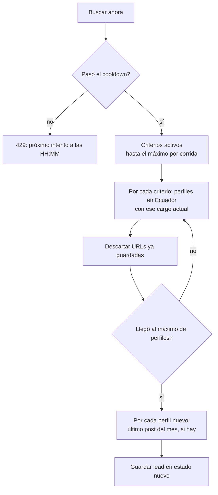

# 08 · Prospección en LinkedIn

> Revisado contra el código el 13/10/2026.

La prospección busca en LinkedIn personas que podrían necesitar a Geeks (por cargo o por empresa), las
ordena por qué tan buen momento es para escribirles y deja que un vendedor decida a quién convertir en
contacto. Reemplaza el barrido manual en LinkedIn: el vendedor ya no busca, revisa.

Tres reglas guían el diseño:

- **Buscar cuesta plata.** Cada perfil traído es una llamada pagada a Apify. Por eso hay topes por
  corrida y un tiempo de espera entre búsquedas amplias.
- **Un lead de LinkedIn no es un contacto.** Igual que en la [Bandeja](./07-bandeja-formulario.md), se
  convierte solo con un clic explícito.
- **La IA redacta, no decide.** La prioridad sale de reglas fijas; la IA solo resume y sugiere un
  primer mensaje con los datos reales del perfil.

## Dónde vive

| Pantalla | Ruta | Quién |
|---|---|---|
| Leads | `/prospeccion-linkedin` | `administrativo` y `ventas` |
| Rendimiento | `/prospeccion-linkedin/rendimiento` | `administrativo` y `ventas` |
| Criterios | `/prospeccion-linkedin/configuracion` | `administrativo` |

Los leads son de la organización, no de un vendedor: todos los del módulo de Ventas ven la misma lista.

## Criterios

Un criterio es un **cargo** (por ejemplo, "Gerente de Marketing") que se busca como cargo actual en
LinkedIn. Cada criterio puede tener una **categoría de servicio**: indica qué le venderíamos a ese perfil
y suma a la prioridad del lead.

Solo los criterios **activos** entran en una búsqueda. Los crea, edita y borra `administrativo`.

## Buscar ahora

**Buscar ahora** corre la búsqueda amplia con Apify:

| Parámetro | Default | Dónde se cambia |
|---|---|---|
| Cooldown entre búsquedas | 6 horas | `configuracion_general.linkedin_cooldown_horas` |
| Criterios por corrida | 5 (los primeros por orden alfabético) | `linkedin_max_criterios_por_corrida` |
| Perfiles por corrida | 25 en total, sumando todos los criterios | `linkedin_max_perfiles_por_corrida` |

Los tres se cambian en Configuración → **Parámetros generales** (solo admin).

**Cooldown.** Es por organización, no por persona: si alguien corrió una búsqueda hace menos de 6 horas,
nadie puede correr otra. El backend responde 429 con la hora del próximo intento y la pantalla
deshabilita el botón hasta entonces. Existe para que la búsqueda amplia no se repita por error y
multiplique el gasto.

**Sin duplicados.** Un perfil cuya URL de LinkedIn ya está guardada (en cualquier estado) no se vuelve a
traer.

**Si Apify falla.** Los leads que se alcanzaron a guardar quedan guardados, la corrida cuenta para el
cooldown y la respuesta es 502 indicando cuántos se guardaron antes del error. Si falla solo la lectura
de posts de un perfil, el perfil se guarda igual y la corrida termina con el aviso de error.

Sin ningún criterio activo, la búsqueda responde 422 y la pantalla pide configurarlos.

**Por qué no se filtra por "publicó hace poco".** En una prueba real, exigir que el perfil haya posteado
en los últimos 30 días dio 0 resultados: la intersección Ecuador + posteo reciente + coincidencia por
texto era demasiado angosta. El post reciente quedó como contexto opcional del lead, no como filtro.

### Buscar por empresa

**Buscar por empresa** trae a la gente que trabaja hoy en una empresa puntual. Es para un vendedor que
está investigando una cuenta:

1. Busca la empresa en LinkedIn por nombre (Apify) y toma su URL. Si no la encuentra, 404.
2. Trae perfiles cuyo empleo actual es esa empresa, con el mismo tope de perfiles por corrida.
3. Guarda los nuevos, con su post reciente si hay.

**No comparte el cooldown** de Buscar ahora: es una acción acotada a una cuenta, no un barrido. Estos
leads no tienen criterio de origen, así que no aparecen en Rendimiento.

## Resultados

La lista se divide por estado: **Nuevos**, **Revisados**, **Descartados** y **Convertidos**. Filtros:
ciudad (texto dentro de la ubicación), categoría del criterio y "Recién en el cargo" (últimos 3, 6 o 12
meses; el corte se aproxima a 30 días por mes).

Cada tarjeta muestra nombre, cargo, empresa, ubicación, desde cuándo está en el cargo, el criterio que lo
trajo con su categoría, el post reciente si hay, y la prioridad.

| Acción | Efecto |
|---|---|
| Marcar revisado | Pasa a Revisados |
| Descartar | Pasa a Descartados |
| Investigar | Ver abajo |
| Convertir | Ver abajo |

Un lead convertido ya no cambia de estado (409).

## Prioridad

La prioridad no se guarda: se calcula cada vez que se lista. La lista se ordena por prioridad y, en
empate, por los más recientes.

| Señal | Puntos |
|---|---|
| Asumió su cargo actual hace ≤ 3 meses | 40 |
| Hace 4 a 6 meses | 25 |
| Hace 7 a 12 meses | 10 |
| Publicó un post en los últimos 30 días | 20 |
| El criterio que lo trajo tiene categoría de servicio | 10 |

Máximo: 70. Desde **40** la tarjeta muestra el badge **Alta prioridad**; entre 1 y 39 muestra el número.

**Por qué el cargo nuevo pesa tanto.** Alguien que acaba de asumir un puesto de decisión suele revisar
proveedores y tiene presupuesto por ejecutar. Es la señal comercial más fuerte que da LinkedIn. La fecha
de inicio del cargo viene con mes y año, sin día; se guarda como el día 1 de ese mes.

## Investigar con IA

**Investigar** hace dos cosas sobre un lead:

1. **Datos de la empresa (Apify, no IA).** Si el lead tiene empresa y todavía no se enriqueció, busca la
   empresa en LinkedIn y guarda industria, tamaño (rango de empleados) y sitio web. Si ya se hizo antes,
   no se vuelve a pagar la llamada.
2. **Resumen y mensaje (IA).** Con nombre, cargo, empresa, industria, tamaño, antigüedad en el cargo y
   post reciente, el modelo devuelve:
   - un **resumen** de 2-3 líneas sobre por qué puede ser buen momento para contactarlo;
   - un **mensaje sugerido** de primer contacto por LinkedIn, en "usted", que mencione algo concreto de
     los datos.

La instrucción al modelo prohíbe inventar datos que no estén en el perfil. El vendedor copia y adapta el
mensaje; prometIO no envía nada a LinkedIn.

Si la IA falla, los datos de la empresa se guardan igual; solo falta el resumen. Proveedor y
configuración en [Integraciones](./11-integraciones.md#ia-anthropic-claude).

## Convertir a contacto

**Convertir** crea un contacto con nombre, URL de LinkedIn, cargo y `fuente = prospeccion_linkedin`. El
cargo, la empresa y el post quedan también en `propiedades_custom`.

- **Duplicado exacto:** si ya existe un contacto con esa URL de LinkedIn, responde 409 y la pantalla
  ofrece ir a ese contacto.
- **Misma empresa:** si ya hay un contacto en una empresa con el mismo nombre, la conversión sigue, pero
  avisa quién es. Sumar un segundo contacto de la misma cuenta es normal en B2B; duplicar a la misma
  persona no.
- **Crear empresa desde la actual** (opcional): busca o crea la empresa por nombre y crea una oportunidad
  en **Clasificación** con asignación automática de vendedor (mismo mecanismo que la Bandeja y el
  formulario, ver [Asignación automática](./07-bandeja-formulario.md#asignacion-automatica)).

El lead queda en Convertidos, enlazado al contacto.

## Rendimiento de criterios

`/prospeccion-linkedin/rendimiento` muestra, por criterio:

| Columna | Cálculo |
|---|---|
| Total leads | Leads traídos por ese criterio, en cualquier estado |
| Convertidos | De esos, los que están en Convertidos |
| Tasa de conversión | `convertidos / total × 100`, con un decimal |

Ordenado por total de leads. Sirve para afinar los criterios con datos de conversión y no a ojo: un
criterio que trae mucho y no convierte está gastando búsquedas.
