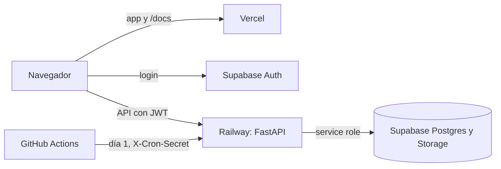

# 13 · Despliegue

> Revisado contra el código el 13/10/2026.

Frontend y backend se despliegan por separado: el frontend en Vercel (`https://prometio.vercel.app`) y el backend en
Railway, región US East (`https://prometio-backend-production.up.railway.app`). La base de datos y el login son un
proyecto de Supabase. Por qué esta combinación está en el [registro de decisiones](./decisiones.md) (ADR-002, ADR-003 y
ADR-011).



## Frontend en Vercel

### Qué se construye

`npm run build` hace tres cosas, en orden:

1. `tsc -b`: si los tipos no compilan, el build se corta.
2. `vite build`: la app, en `dist/`.
3. El sitio de documentación (VitePress), en `dist/docs`, con base `/docs/`.

Vercel publica `dist/`. La app queda en la raíz y la documentación en `/docs`.

### Rutas (`vercel.json`)

| Regla | Para qué |
|---|---|
| `/formulario-demo` → `/formulario-demo/index.html` | La página de prueba del formulario web es un HTML propio, no la SPA |
| Todo lo demás → `/index.html` | La SPA resuelve sus rutas en el navegador (React Router). Los archivos que existen en `dist/`, como los de `/docs` y `/widget/`, se sirven tal cual |

### Cabeceras de seguridad

Hay tres reglas de cabeceras en `vercel.json`. Por qué y qué protege cada una está en [Seguridad](./14-seguridad.md#csp-y-cabeceras).

| Rutas | Cabeceras |
|---|---|
| Todo menos `/formulario-demo` y `/widget/` | CSP del CRM: solo scripts propios, conexiones solo al backend, Supabase y Sentry, sin frames |
| `/formulario-demo` y `/widget/` | CSP propia que además permite hCaptcha y Google Fonts |
| Todas | `X-Content-Type-Options`, `X-Frame-Options: DENY`, `Referrer-Policy`, `Permissions-Policy` y HSTS |

Si cambias la URL del backend o el proyecto de Supabase, actualiza `connect-src` en la misma entrega. Si no, el
navegador bloquea las peticiones (ver [Operación](./operacion.md#errores-de-csp-en-la-consola)).

### Variables en Vercel

Se cargan en Vercel → Environment Variables. Todas son `VITE_*`: se fijan al compilar, así que **después de cambiar
una hay que volver a desplegar**.

| Variable | Producción |
|---|---|
| `VITE_SUPABASE_URL`, `VITE_SUPABASE_ANON_KEY` | Obligatorias |
| `VITE_API_URL` | Obligatoria: la URL del backend en Railway, sin barra final. Sin ella la app no funciona |
| `VITE_BASECAMP_CLIENT_ID` | La de la integración de producción (redirect a `https://prometio.vercel.app/auth/basecamp/callback`) |
| `VITE_SENTRY_DSN`, `VITE_SENTRY_ENVIRONMENT` | Pendiente: cargar el DSN del proyecto de Sentry del frontend |

`DEV_API_PROXY_TARGET` y `DEV_SERVER_*` no van en Vercel: solo sirven para `npm run dev`.

### Cómo llega un cambio a producción

1. Rama y PR contra `main`. El CI corre en cada PR y en cada push a `main`.
2. Merge a `main`.
3. Vercel construye y publica. Por confirmar: el repo no tiene un workflow de despliegue, así que lo dispara la
   integración de Git de Vercel.

## Sitio de documentación

Se publica con el frontend, en el mismo despliegue: no hay un paso aparte. Las páginas llevan `noindex, nofollow`,
pero el sitio es público para quien tenga la URL. Por eso nunca lleva secretos, claves, datos personales ni
identificadores del proyecto de Supabase.

## Backend en Railway

### Imagen

Railway construye con el `Dockerfile` del repo (`railway.json` fija `builder: DOCKERFILE`), no con el buildpack de
Python. Por qué: WeasyPrint necesita librerías nativas que el buildpack no trae.

- Base `python:3.11-slim` fijada por digest. Un tag puede cambiar por debajo; el digest no. Dependabot propone el
  digest nuevo por PR.
- Instala `libpango-1.0-0`, `libpangoft2-1.0-0` y `libharfbuzz-subset0` para los PDF.
- Dependencias exactas desde `requirements.lock`, con `--require-hashes`.
- Corre como un usuario sin privilegios, no como root.
- Arranca `uvicorn` con `--proxy-headers`, para que la IP real del cliente y el esquema https lleguen a la app (los
  límites de tasa y la auditoría los usan).

Para regenerar el lockfile después de cambiar dependencias en `pyproject.toml`, el comando exacto está en el
comentario del `Dockerfile`.

### Variables en Railway

Se cargan en Railway → Variables. La lista completa y qué pasa si falta cada una está en
[Setup](./12-setup.md#variables-del-backend). En producción, además:

- No hace falta `ENVIRONMENT`: Railway define `RAILWAY_ENVIRONMENT` y con eso el backend se pone en modo producción
  (sin `/docs` ni OpenAPI, CORS solo https, HSTS).
- `CORS_ALLOW_ORIGINS` debe incluir `https://prometio.vercel.app`.
- `CRON_SECRET` debe tener el mismo valor que el secreto `CRON_SECRET` del repo en GitHub.

### Cómo llega un cambio a producción

1. Rama y PR contra `main`. El CI del backend corre `ruff`, `pytest` (con Postgres y las librerías de WeasyPrint) y
   `pip-audit`.
2. Merge a `main`. Railway despliega la rama conectada. Por confirmar en el panel de Railway cuál es.
3. Comprueba `/health` y la pantalla [Salud del sistema](./operacion.md#salud-del-sistema).

Regla del backend: ningún cambio que amplíe lo que se expone en una respuesta de error (mensajes de excepción, stack
traces) se sube a la rama que despliega a producción, ni siquiera de forma temporal. Para diagnosticar se usan los
logs de Railway.

## Migraciones

Las migraciones son archivos SQL numerados en `prometio-backend/supabase/migrations/` (hoy, hasta la `0094`). Se
aplican en orden numérico, de una de dos formas:

```bash
# Opción A: Supabase CLI, desde prometio-backend
supabase login
supabase link --project-ref <project-ref>
supabase db push        # aplica las pendientes, en orden
```

Opción B: en el **SQL Editor** de Supabase, pegando cada archivo y ejecutándolo uno por uno, en orden.

Reglas que vienen de errores reales:

- **Primero el código, después la migración que lo necesita**, salvo que la migración diga lo contrario. Ejemplo: la
  `0094` (bucket de documentos de alcance privado) se corre después de desplegar el backend que sirve el PDF. Si se
  corre antes, el PDF aprobado deja de abrirse hasta el despliegue.
- **Una migración que siembra datos verifica cuántas filas insertó** y falla si no son las esperadas. Ya pasó dos
  veces que una migración insertó 0 filas sin error.
- **Después de una migración de seguridad (RLS)**, abre Supabase Advisor (Security) y compara las políticas reales con
  las del repo. El repo no ve la base viva.
- `supabase/pendientes/` guarda migraciones que se aplican a mano, fuera del flujo normal, después de una
  coordinación. Una vez aplicadas pasan a `supabase/migrations/`, como la `0093` (quitar las escrituras directas a
  las tablas de dominio), aplicada el 13/10/2026.

## CI y Dependabot

| Repo | CI (en cada PR y en cada push a `main`) | Dependabot |
|---|---|---|
| Frontend | `npm ci`, lint, `tsc -b --noEmit`, build y `npm audit --omit=dev --audit-level=high`, que **bloquea**. Una auditoría completa informativa que no bloquea | npm y GitHub Actions, cada lunes (hora de Guayaquil). Menores y parches juntos en un PR; los major por separado |
| Backend | `ruff`, `pytest`, `pip-audit` | pip y Docker cada semana; GitHub Actions cada mes |

Por qué la auditoría del frontend solo bloquea en producción: las vulnerabilidades altas que quedan son de la CLI de
`shadcn`, que se usa al compilar y no llega al navegador.

Pendiente: marcar el CI como check obligatorio en la protección de `main` de los dos repos.

## Volver atrás

| Qué | Cómo |
|---|---|
| **Frontend** | En el panel de Vercel, promover a producción un despliegue anterior que funcionaba. Después, revertir el commit en `main` (`git revert`) para que el próximo despliegue no traiga el error de vuelta |
| **Backend** | En el panel de Railway, volver a desplegar un despliegue anterior. Después, `git revert` en `main` |
| **Migración** | No hay migraciones de bajada. Se escribe una migración nueva que deshaga el cambio. Si una migración de permisos rompe algo, primero se restaura el permiso. Ejemplo, para la `0093`: `GRANT INSERT, UPDATE, DELETE ON <tablas> TO authenticated;` |
| **Variable de entorno** | Volver al valor anterior y redesplegar. En Vercel es obligatorio redesplegar; en Railway el cambio de variables dispara un despliegue nuevo (por confirmar) |

Si el rollback del backend cruza una migración (el código viejo no conoce una columna o tabla nueva), revisa primero
que el código anterior funcione con el esquema actual.
