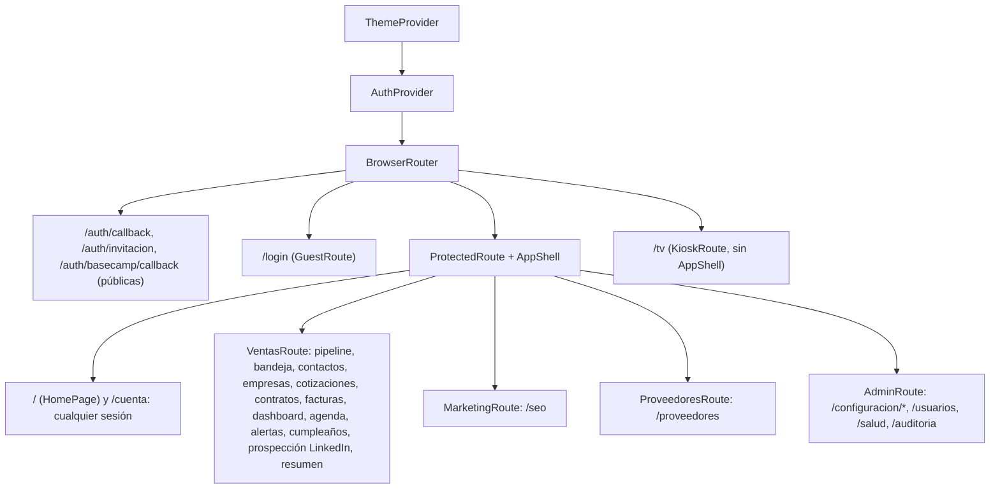
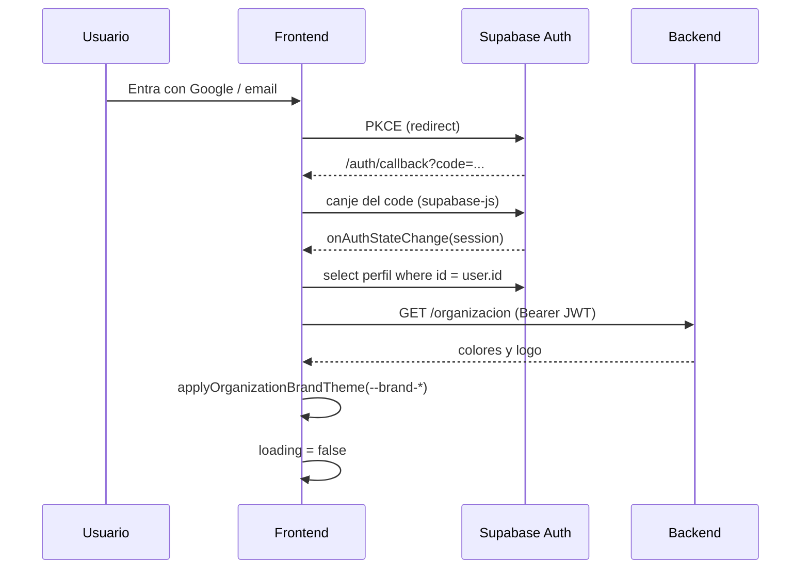

# 15 · Arquitectura del frontend

> Revisado contra el código el 13/10/2026.

Documento para quien va a **mantener** el frontend de prometIO: cómo está organizado el código, por dónde entra un
usuario, cómo se habla con el backend y dónde no conviene tocar sin entender por qué está así. Las páginas `00`–`11`
explican el *qué* de cada módulo; esta explica el *cómo*.

El frontend es una SPA: no tiene servidor propio ni lógica de negocio. Todo lo que decide (permisos, cálculos de
cotización, transiciones de estado) lo decide el backend. El frontend muestra, pide y respeta lo que el backend responde.

---

## 1. Stack

| Pieza | Uso |
|---|---|
| React 18 + TypeScript 5.9 | UI |
| Vite 8 | Dev server y build. Alias `@/` → `src/` |
| React Router 7 (modo librería, `BrowserRouter` + `<Routes>`) | Rutas, todas declaradas en `src/App.tsx` |
| Tailwind CSS 4 + shadcn/ui (sobre Radix) | Estilos y componentes base (`src/components/ui`) |
| Zustand 5 | Estado global mínimo: sesión, perfil y organización |
| `@supabase/supabase-js` | Solo autenticación (y leer el propio `perfil`) |
| `@dnd-kit` | Kanban arrastrable del pipeline |
| Tiptap 3 | Editor de texto enriquecido del Documento de Alcance |
| Recharts 3 | Gráficos del dashboard y del resumen |
| Sonner | Toasts (`toast.error(detail)`) |
| Sentry (`@sentry/react`) | Errores de runtime, opcional por variable de entorno |
| Lucide | Única librería de íconos |
| oxlint | Lint |

No hay librería de tablas: las tablas usan el componente `Table` del sistema (`src/components/ui/table.tsx`).
Desplegado en Vercel (`https://prometio.vercel.app`). Ver [Despliegue](./13-despliegue.md).

---

## 2. Mapa de carpetas

```
prometio-frontend/
├── index.html            Carga /theme-init.js (tema oscuro antes del primer render) y src/main.tsx
├── public/
│   ├── theme-init.js     Lee localStorage y pone .dark antes de pintar (fuera del HTML por la CSP)
│   ├── widget/           Widget embebible del formulario web (prometio-form.js) y su preview
│   └── formulario-demo/  Página de prueba del widget
├── src/
│   ├── main.tsx          Arranca Sentry, normaliza la ruta de invitación, monta <App/> dentro de un ErrorBoundary
│   ├── App.tsx           Todas las rutas y sus guards
│   ├── index.css         Tokens de diseño (único lugar con hex) y utilidades de tipografía/superficie
│   ├── pages/            Una página por ruta (~50)
│   ├── components/       Componentes por dominio (pipeline/, bandeja/, contratos/, ...) + transversales
│   │   └── ui/           Primitivas shadcn (button, badge, table, dialog, select, ...)
│   ├── lib/
│   │   ├── api-client.ts apiFetch / apiFetchBlob / ApiError
│   │   ├── api/*.ts      Un archivo por dominio del backend (29 archivos)
│   │   ├── config-api.ts Catálogos y Panel de Configuración (admin)
│   │   ├── *-visual.ts   Catálogos de ícono y color por tipo (ver sección 7)
│   │   ├── supabase.ts   Cliente de Supabase (auth)
│   │   ├── theme.ts      Tokens --brand-* de la organización
│   │   ├── rango-datetime-ecuador.ts  Rangos de día calendario en -05:00
│   │   └── mock-*.ts     Restos de la etapa localStorage. No usar (ver sección 9)
│   ├── store/            auth-store.ts, org-store.ts (Zustand)
│   ├── hooks/            use-dashboard-datos.ts
│   └── types/            Tipos del dominio, uno por entidad (espejo de los modelos Pydantic)
├── docs/                 Este sitio (VitePress)
└── vercel.json           Rewrites de SPA, CSP y cabeceras de seguridad
```

| Carpeta | Responsabilidad | Lo que **no** va ahí |
|---|---|---|
| `pages/` | Componer la pantalla, leer parámetros de ruta, cargar datos con `lib/api` | Lógica de negocio, fetch directo |
| `components/<dominio>/` | Piezas reutilizables de un módulo (diálogos, tablas, badges de estado) | Llamadas a Supabase |
| `components/ui/` | Primitivas visuales genéricas | Reglas de dominio |
| `lib/api/` | Una función por endpoint, tipada | Estado global, toasts |
| `lib/*.ts` (resto) | Helpers puros: formateo, rangos de fecha, espejos de permisos, transiciones permitidas | Hex, componentes |
| `types/` | Tipos de request/response | Valores por defecto |

---

## 3. Rutas y guards

Todas las rutas viven en `src/App.tsx`. El árbol tiene tres niveles:



Los guards están en `src/components/auth-routes.tsx` y leen el `perfil` del `auth-store`:

| Guard | Deja pasar | Si no |
|---|---|---|
| `ProtectedRoute` | Cualquier sesión de Supabase | `/login` |
| `KioskRoute` | Cualquier sesión (alias para `/tv`, cuenta dedicada sin AppShell) | `/login` |
| `GuestRoute` | Solo sin sesión | `/` |
| `VentasRoute` | `equipo` = `administrativo` o `ventas` | `/` |
| `MarketingRoute` | `administrativo` o `marketing` | `/` |
| `ProveedoresRoute` | `administrativo` o `proveedores` | `/` |
| `AdminRoute` | `administrativo` | `/` |

Mientras `loading` es `true` todos muestran un spinner, para no redirigir antes de saber quién es el usuario.

**Por qué los guards no son seguridad.** Son espejo de las dependencias del backend (`require_acceso_ventas`,
`require_admin`, etc.; ver [Arquitectura del backend](./16-arquitectura-backend.md)). Ocultan lo que el usuario no
puede usar, pero la barrera real es el backend: si alguien fuerza una ruta, la API responde 403. Los helpers de
`src/lib/pipeline-acceso.ts` (`esSoloLoPropio`, `puedeVerEquipo`, `puedeVerDesgloseCotizacion`, ...) siguen el mismo
criterio y están nombrados como sus pares en Python.

Hay rutas anidadas con layout propio (`/contratos`, `/prospeccion-linkedin`, `/configuracion/servicios`) y
redirecciones de rutas viejas (`/configuracion/proveedores` → `/proveedores`,
`/configuracion/linkedin-criterios` → `/prospeccion-linkedin/configuracion`). Cualquier ruta desconocida va a `/`.

---

## 4. Autenticación

El login es de Supabase Auth (email o Google) con **flujo PKCE** (`src/lib/supabase.ts`: `flowType: "pkce"`,
`persistSession: true`, `detectSessionInUrl: true`). La sesión se guarda en `localStorage` y supabase-js la refresca
sola.



`AuthProvider` (`src/components/auth-provider.tsx`) hace todo esto:

1. Se suscribe **solo** a `onAuthStateChange`. No llama a `getSession()` en paralelo: eso marcaba `loading=false` con
   sesión nula durante el canje PKCE y `ProtectedRoute` mandaba a `/login`, borrando el `code` de la URL.
2. Si hay una invitación o un canje PKCE pendiente en la URL (`src/lib/auth-invite.ts`), no marca `loading=false`
   hasta que supabase-js termine.
3. Con usuario: lee su fila de `perfil` (`src/lib/perfil-api.ts`, única lectura directa a Supabase del dominio),
   luego `GET /organizacion` al backend y aplica los colores de marca.
4. Sin usuario: limpia perfil, organización y tokens de marca.

`signOut()` del `auth-store` cierra la sesión en Supabase, limpia la organización y el tema de marca, y desasocia el
usuario de Sentry.

---

## 5. Hablar con el backend

Todo el dominio va por HTTP con `apiFetch` / `apiFetchBlob` (`src/lib/api-client.ts`). **Nada del dominio va directo
a Supabase.**

```
página → lib/api/<dominio>.ts → apiFetch(path, init) → fetch(VITE_API_URL + path, Authorization: Bearer <JWT>)
```

| Detalle | Comportamiento |
|---|---|
| Base URL | `VITE_API_URL` (sin barra final). En `npm run dev` sin esa variable usa `/api-backend`, que Vite proxea a `DEV_API_PROXY_TARGET`. En producción sin `VITE_API_URL` falla con `Falta VITE_API_URL.` |
| Cabeceras | `Accept: application/json`, `Content-Type: application/json` si hay body (salvo `FormData`) y el `access_token` de la sesión |
| `204` | Devuelve `undefined` |
| Error | Lanza `ApiError` con `status`, `detail` y `retryAfter` |
| Binarios | `apiFetchBlob` devuelve `{ blob, filename }` leyendo `Content-Disposition` (PDF de cotización, DOCX del documento de alcance) |

### `ApiError` y los códigos que se tratan aparte

FastAPI responde los errores como `{ "detail": "..." }`. `leerDetail` acepta `detail` como texto o como la lista de
errores de validación de Pydantic (une los `msg`). La convención en pantalla es `toast.error(error.detail)` o
`error.message`.

| Código | Qué hace el cliente |
|---|---|
| `429` | `ApiError` con `retryAfter` leído de `Retry-After` y un `message` amable ("Probá de nuevo en N s."). `detail` conserva el texto del backend, porque hay pantallas que lo parsean (el enfriamiento de LinkedIn) |
| `409` | Sin tratamiento global. `esConflicto(error)` lo detecta: es una transición que otra petición ya aplicó; la pantalla debe recargar el registro |
| `403` "cuenta está desactivada" | Cierra la sesión una sola vez (toast de 15 s con id fijo, aunque fallen varias peticiones en paralelo) |
| Resto | `ApiError(status, detail)` |

### Un archivo por dominio

`src/lib/api/` tiene un archivo por router del backend (`oportunidad.ts`, `cotizacion.ts`, `contrato-recurrente.ts`,
`documento-alcance.ts`, `prospeccion-linkedin.ts`, ...). La configuración de admin (etapas, márgenes, catálogos,
categorías) vive en `src/lib/config-api.ts`. Los tipos de cada respuesta están en `src/types/`.

Fechas y horas se tratan en hora de Ecuador, offset fijo `-05:00` sin horario de verano. Para filtrar "un día
calendario" se usan los helpers de `src/lib/rango-datetime-ecuador.ts`, nunca la zona del navegador.

---

## 6. Estado

El estado global es deliberadamente chico. Cada página carga sus datos y los guarda en estado local.

| Store | Contenido | Quién escribe |
|---|---|---|
| `auth-store` | `session`, `user`, `perfil`, `loading`, `signOut()` | `AuthProvider` y `apiFetch` (cierre por cuenta desactivada) |
| `org-store` | `organizacion` (nombre, logo, colores) | `AuthProvider` y la pantalla de Marca |

`apiFetch` lee la sesión con `useAuthStore.getState()`, fuera de React, para no depender de un hook.

**Tema claro/oscuro.** `ThemeProvider` guarda la elección en `localStorage` (`prometio-theme`: `light`, `dark` o
`system`) y `public/theme-init.js` la aplica antes del primer render. El tema también vive en `perfil.tema_preferido`
para seguir al usuario entre equipos: `TemaPerfilSync` lo aplica al iniciar sesión si ese navegador todavía no tiene
una elección, y `ModeToggle` guarda claro u oscuro en el perfil (`PATCH /perfiles/me`). «Sistema» solo existe en el
navegador.

---

## 7. Catálogos visuales

Un tipo de un enum cerrado (tipo de actividad, modelo de tarifa, evento del timeline, ...) tiene **un solo** lugar
donde se define su ícono y su color: un archivo `src/lib/*-visual.ts`. Los componentes solo consumen.

| Archivo | Mapa |
|---|---|
| `actividad-visual.ts` | `TIPO_ACTIVIDAD_VISUAL`: llamada, whatsapp, visita, videollamada, email, tarea interna |
| `calendario-visual.ts` | `CALENDARIO_EVENTO_VISUAL`: eventos del calendario (cumpleaños, vencimiento de cotización, ...) |
| `timeline-visual.ts` | `TIMELINE_EVENTO_VISUAL`: tipos de evento del timeline |
| `tarifa-visual.ts` | `TARIFA_MODELO_VISUAL`: por hora, por sueldo, por evento |
| `salud-visual.ts` | `SALUD_SERVICIO_VISUAL`: servicios del panel de salud |
| `inicio-sugerencias-visual.ts` | `SUGERENCIA_TIPO_VISUAL`, `PRIORIDAD_BADGE`: sugerencias de la pantalla de Bienvenida |
| `conectores-visual.ts` | `CONECTOR_VISUAL`: Claude, ChatGPT, Gemini |

Los colores son clases de tokens (`bg-kind-llamada/15 text-kind-llamada`), no hex. El render lo hace `KindMark`. Las
reglas completas están en [Sistema de diseño](./19-sistema-diseno.md).

---

## 8. Cómo se construye una pantalla nueva

1. **Endpoint.** Confirma el contrato en el backend (router + modelo Pydantic). Si no existe, se pide en el backend;
   el frontend no lo inventa.
2. **Tipos.** `src/types/<entidad>.ts` con la forma exacta de la respuesta.
3. **Cliente.** Funciones en `src/lib/api/<dominio>.ts` que llaman a `apiFetch`. Nada de `fetch` suelto.
4. **Página.** `src/pages/<Nombre>Page.tsx` con `PageHeader`, filtros `filter-bar` / `filter-field` y estados de
   carga (`skeleton`), vacío (`EmptyState`) y error (`toast.error(detail)`).
5. **Ruta.** En `src/App.tsx`, dentro de `ProtectedRoute` + `AppShell` y con el guard que espeja la dependencia del
   backend (`VentasRoute` si el endpoint usa `require_acceso_ventas`, etc.).
6. **Navegación.** Entrada en el nav (`src/components/app-nav.tsx` / `sidebar-nav.ts`, o `config-nav.ts` para
   Configuración) con su ícono de wayfinding.
7. **Diseño.** Nace con el lenguaje de Fase C y usable en móvil (ver [Sistema de diseño](./19-sistema-diseno.md)). No
   es un pase posterior.
8. **Listas.** Si la pantalla necesita un dato por fila, pide un endpoint agregado. Un `GET` por fila en paralelo ya
   tumbó el backend una vez (ver [Arquitectura del backend](./16-arquitectura-backend.md#cliente-supabase-compartido)).
9. **Antes de commitear:** `npm run build` (`tsc -b` + Vite + este sitio) y `npm run lint`.

---

## 9. Deuda conocida

| Deuda | Detalle | Riesgo |
|---|---|---|
| `src/lib/mock-*.ts` | `mock-actividad`, `mock-alerta`, `mock-cotizacion`, `mock-empresa`, `mock-oportunidad` y `mock-config` son restos de cuando el dominio vivía en `localStorage`. Ninguna página los usa para leer o escribir; solo se importan entre sí | Confunden al leer el código. Candidatos a borrarse |
| `MOCK_ORGANIZACION_ID` | Sale de `mock-config.ts`, se reexporta en `config-api.ts` y `ServicioWizardPage` lo usa como respaldo si el perfil no tiene `organizacion_id` | Es lo único que mantiene vivo `mock-config.ts`. Debería salir del perfil siempre |
| Componentes grandes | `DocumentoAlcanceWizard.tsx` (~1.000 líneas), `LineaCotizacionForm.tsx` (~890), `wizard-pasos.tsx` (~650), `ProspeccionLinkedInPage.tsx` (~650), `FacturasPage.tsx` (~560) | Difíciles de revisar y de probar |
| Bundle único | Todas las páginas se importan de forma estática en `App.tsx` (sin `React.lazy`). El build genera un solo JS de unos 2 MB sin comprimir | Primera carga lenta en móvil. Partir por ruta es el arreglo obvio |
| `README.md` desactualizado en theming | Dice que la organización pisa `--primary`; desde ADR-022 pisa solo `--brand-*` | Documentación, no código |

---

## 10. Dónde mirar cuando algo falla

| Síntoma | Dónde mirar |
|---|---|
| Rebota a `/login` justo después de entrar con Google | `AuthProvider` y `src/lib/auth-invite.ts`: canje PKCE en curso. Ver que no se haya agregado un `getSession()` paralelo |
| Entra pero no ve un módulo | `perfil.equipo` / `rol_ventas` y el guard de la ruta en `App.tsx` |
| Toast "Tu cuenta está desactivada" y sale solo | Esperado: el backend respondió 403 por `perfil.activo = false` (`api-client.ts`) |
| Toast "Hiciste muchas solicitudes seguidas" | 429 del límite de tasa del backend (IA, PDF, SEO, formulario). Esperar `Retry-After` |
| "El registro cambió de estado mientras lo procesabas" | 409 de una transición atómica. Recargar el registro |
| `Falta VITE_API_URL.` en producción | Variable de entorno de Vercel |
| Errores de CORS o "Failed to fetch" | `VITE_API_URL` mal escrito, o el origen no está en `cors_allow_origins` del backend. En local, `DEV_API_PROXY_TARGET` |
| Colores de cotización o widget incorrectos | `GET /organizacion` y `src/lib/theme.ts` (`--brand-*`) |
| Flash claro al cargar en modo oscuro | `public/theme-init.js` y la clave `prometio-theme` |
| Una pantalla se queda en blanco | Sentry (si `VITE_SENTRY_DSN` está cargado) y la consola; el `ErrorBoundary` de `main.tsx` muestra `ErrorFallback` |
| Fechas corridas un día | Usar `rango-datetime-ecuador.ts`, no `new Date()` local |

Relacionado: [Arquitectura del backend](./16-arquitectura-backend.md), [API REST](./18-api.md),
[Sistema de diseño](./19-sistema-diseno.md), [Operación](./operacion.md).
