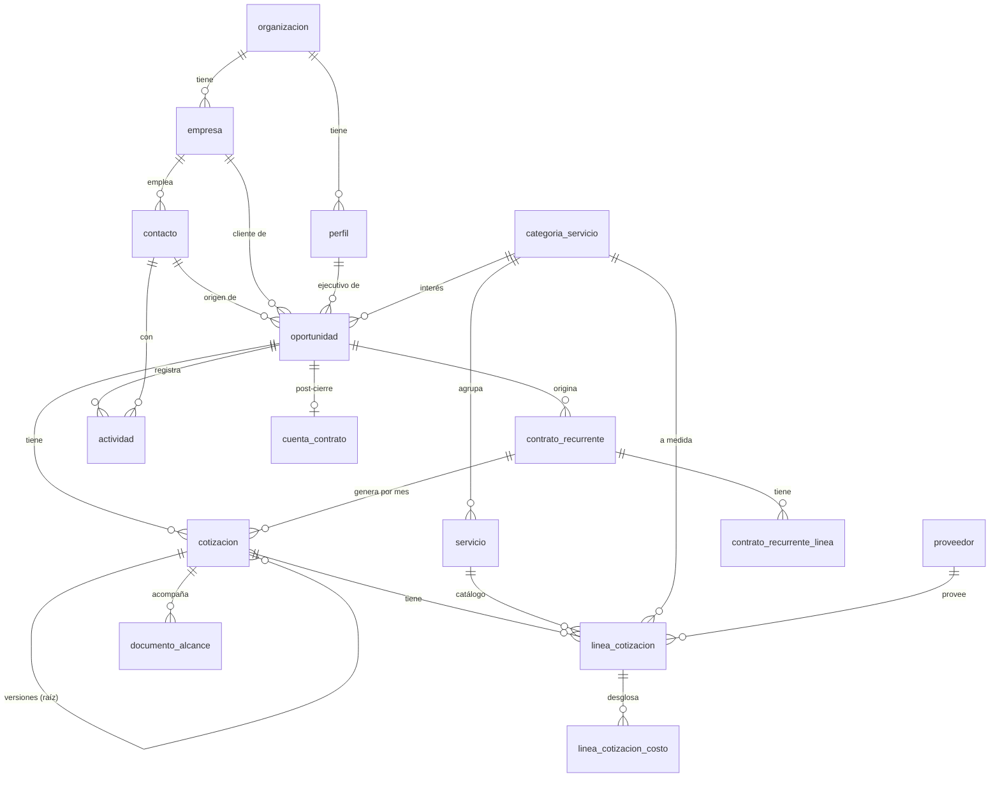

# 17 · Modelo de datos

> Revisado contra las migraciones el 13/10/2026 (`prometio-backend/supabase/migrations`, hasta la 0094).

Cómo están organizados los datos de prometIO y qué reglas los protegen. Es Postgres en Supabase, con el esquema
definido **solo** por migraciones SQL numeradas. El documento histórico `prometio-backend/docs/DATA_MODEL.md` explica el
diseño original; donde difiere de esta página, mandan las migraciones.

## Principios

1. **Todo cuelga de `organizacion_id`.** Hoy hay una sola organización (Geeks Ecuador), pero toda tabla de negocio la
   referencia para poder clonar el sistema a otra empresa sin rehacer el modelo.
2. **Un lead no es una tabla.** `etapa_ciclo_vida` es una propiedad de `contacto` (`contacto` / `lead` / `cliente`).
3. **Permisos en la base.** Las políticas RLS replican la matriz de acceso (ver [Roles y permisos](./01-roles-permisos.md)).
   El backend además los aplica en código, porque escribe con `service_role` (sección "RLS").
4. **Nada paramétrico en el código.** Probabilidades, umbrales, márgenes, comisiones, tasa de impuesto, catálogos: todo
   vive en tablas editables desde el Panel de Configuración.
5. **Costeo interno por rol**, nunca por persona (`tarifa_interna.nombre_rol`).
6. **Baja lógica.** Contactos, empresas, proveedores, oportunidades, perfiles y contratos se desactivan con `activo`;
   no se borran.
7. **Instantes en `TIMESTAMPTZ`, días en Ecuador** (UTC-5 fijo) cuando importa el día calendario.

## Cómo se relacionan

El núcleo comercial:

---

## Tablas por dominio

### Organización y personas

| Tabla | Para qué | Columnas clave |
|---|---|---|
| `organizacion` | La empresa que usa prometIO. Una fila | `nombre`, `logo_url`, `logo_url_oscuro`, `color_primario` … `color_cuaternario` (marca para entregables), `sitio_web_url`, `email`, `telefono`, `formulario_*` (apariencia y textos del widget) |
| `perfil` | Un usuario. `id` = `auth.users.id` | `equipo` (`administrativo` / `ventas` / `marketing` / `proveedores`), `rol_ventas` (`vendedor` / `supervisor`, solo si `equipo = ventas`), `activo`, `tema_preferido`, `telefono`, `linkedin_url` |
| `auditoria` | Acciones sensibles, quién y desde dónde | `perfil_id`, `accion`, `entidad_tipo`, `entidad_id`, `resultado` (`exito` / `fallo`), `ip`, `detalle` |
| `timeline_evento` | Historia comercial legible (cambios de etapa, cotizaciones, ...) | `perfil_id`, `tipo_evento`, `entidad_tipo`, `entidad_id`, `detalle` |

Al crearse un usuario en Supabase Auth, el trigger `on_auth_user_created` (`handle_new_user`) crea su `perfil` como
`ventas` / `vendedor`. La invitación desde Usuarios ajusta después el equipo y el rol.

### Contactos y empresas

| Tabla | Para qué | Columnas clave |
|---|---|---|
| `empresa` | Cuenta cliente o prospecto | `nombre`, `ruc`, `web`, `sector`, `tamano_estimado`, `linkedin_url`, `logo_url`, `datos_enriquecidos` (JSONB, del enriquecimiento automático), `propiedades_custom`, `activo` |
| `contacto` | Persona. También es el lead | `nombre_completo`, `email_trabajo`, `telefono_movil`, `empresa_id`, `cargo`, `etapa_ciclo_vida`, `elegible_marketing`, `fuente`, `utm_*`, `gclid`, `fclid`, `fecha_nacimiento`, `foto_url`, `creado_por`, `propiedades_custom`, `activo` |

### Pipeline

| Tabla | Para qué | Columnas clave |
|---|---|---|
| `oportunidad` | Un negocio en el pipeline | `nombre`, `contacto_id`, `empresa_id`, `ejecutivo_id`, `etapa`, `valor_referencial` (estimado), `valor_cotizado` (en firme), `cotizacion_valor_activa_id`, `probabilidad_cierre`, `categoria_interes_id`, `causa_perdida_principal_id` / `_secundaria_id`, `competidor_mencionado`, `fecha_ultima_actividad`, `fecha_cierre`, `activo` |
| `etapa_pipeline` | Las 9 etapas y sus parámetros | `codigo`, `nombre`, `orden`, `probabilidad_cierre_default_pct`, `umbral_alerta_horas` (NULL en cierres) |
| `causa_perdida` | Catálogo de causas de Cierre Perdido | `nombre` |
| `cuenta_contrato` | Referencia post-cierre (no es gestión de proyectos) | `oportunidad_id`, `fase_actual`, `basecamp_url`, `es_recurrente`, `monto_recurrente`, `fecha_renovacion` |
| `meta_comercial` | Meta mensual o trimestral, por vendedor o total | `perfil_id` (NULL = agencia), `periodo_tipo`, `fecha_inicio`, `fecha_fin`, `monto` |
| `asignacion_geografica` | Provincia → ejecutivo, para el reparto de leads | `provincia`, `ejecutivo_id` |

`valor_cotizado` manda sobre `valor_referencial`. `cotizacion_valor_activa_id` dice qué cotización lo sustenta, para
poder revertirlo si esa cotización termina rechazada o vencida y para que una aprobada gane siempre.

### Servicios y costeo

| Tabla | Para qué | Columnas clave |
|---|---|---|
| `servicio` | Catálogo de servicios (wizard de 8 pasos) | `nombre`, `descripcion`, `categoria_id`, `pilar`, `modelo_cobro` (`por_hora` / `fee_fijo` / `fee_recurrente`), `tiene_fases`, `fases`, `config_fee`, `precio_base_cliente`, `estimacion_interna_por_rol` (JSONB), `margen_default_pct`, `comision_sugerida_min_pct` / `_max_pct`, `tipos_documento_requeridos`, `requiere_documento_alcance`, `estado` (`borrador` / `activo` / `archivado`), `contifico_producto_id` |
| `categoria_servicio` | Agrupa servicios y líneas a medida | `nombre` (único), `pilar` (`marca` / `crecimiento` / `transformacion` / `transversal`, NULL en filas viejas) |
| `tarifa_interna` | Costo interno por rol | `nombre_rol`, `modelo` (`por_hora` / `por_sueldo` / `por_evento`), `costo_hora`, `costo_mensual`, `costo_evento` |
| `proveedor` | Proveedores externos | `nombre`, `contacto_nombre`, `ruc`, `telefono`, `email`, `calificacion` (1–5), `servicios`, `observaciones`, `activo` |
| `tipo_documento` | Catálogo abierto de documentos requeridos | `nombre`, `plantilla_base`, `plantilla_url` |

### Cotizaciones

| Tabla | Para qué | Columnas clave |
|---|---|---|
| `cotizacion` | Una propuesta económica de una oportunidad | `numero` (`COT-000001`, de una secuencia), `oportunidad_id`, `estado`, `requiere_aprobacion`, `aprobado_por`, `tasa_impuesto_pct_aplicada`, `valido_hasta`, `version`, `cotizacion_raiz_id`, `requiere_documento_alcance`, `numero_factura`, `contrato_recurrente_id`, `periodo_contrato` |
| `linea_cotizacion` | Una línea | `servicio_id` (NULL = a medida), `categoria_servicio_id`, `descripcion`, `proveedor_id`, `costo_proveedor`, `margen_pct`, `comision_agencia_pct`, `cantidad`, `precio_base_cliente_aplicado`, `precio_venta_base_manual`, `justificacion_precio` |
| `linea_cotizacion_costo` | Desglose de costos internos de una línea (varios proveedores) | `linea_cotizacion_id`, `proveedor_id`, `descripcion`, `monto` |
| `documento_alcance` | Documento de Alcance de una cotización, versionado | `cotizacion_id`, `version`, `documento_raiz_id`, secciones de contenido, `estado` (`borrador` / `pendiente_aprobacion` / `aprobado` / `rechazado`), `generacion_ia_estado`, `pdf_url`, `docx_subido_url`, `resumen_cambios`, `auditoria_ia` |

Estados de `cotizacion`: `borrador`, `preparacion`, `enviada`, `aprobada`, `por_facturar`, `facturado`, `rechazada`,
`vencida`. Un `CHECK` exige `numero_factura` no vacío en `facturado`. Los tres estados de "ganada" (`aprobada`,
`por_facturar`, `facturado`) cuentan igual en las métricas.

Reglas del cálculo:

- `tasa_impuesto_pct_aplicada` es NULL mientras la cotización está en borrador o preparación (se calcula en vivo con
  `configuracion_general.tasa_impuesto_pct`) y se congela **una vez**, al pasar a `enviada`.
- `costo_proveedor` es la fuente del motor de márgenes. Si la línea tiene filas en `linea_cotizacion_costo`, el backend
  recalcula `costo_proveedor` como su suma: el desglose es para mostrar, no un cálculo paralelo. Nunca sale en el PDF
  de cliente.
- Versiones: `cotizacion_raiz_id` apunta a la primera versión (NULL si esta es la raíz). La versión aprobada es la que
  tenga estado de ganada dentro de la cadena.
- Línea a medida (`servicio_id` NULL): lleva `categoria_servicio_id`. Línea de catálogo: la categoría se hereda del
  servicio.

Detalle funcional en [Cotizaciones y motor de márgenes](./03-cotizaciones.md).

### Contratos de fee

| Tabla | Para qué | Columnas clave |
|---|---|---|
| `contrato_recurrente` | Cliente con fee mensual y vigencia | `empresa_id`, `contacto_id`, `oportunidad_id`, `nombre`, `fecha_inicio`, `fecha_fin` (≥ inicio), `activo`, `notas`, `creado_por` |
| `contrato_recurrente_linea` | Montos mensuales del contrato | `contrato_id` (borrado en cascada), `servicio_id` o `categoria_servicio_id` (al menos uno), `descripcion`, `monto_mensual` (> 0) |

Cada mes se genera una `cotizacion` con `contrato_recurrente_id` y `periodo_contrato` (siempre el día 1 del mes). Un
índice único parcial sobre `(contrato_recurrente_id, periodo_contrato)` impide duplicar un mes aunque el cron corra dos
veces. No reutiliza `cuenta_contrato`, que es otro concepto. Ver [Contratos de fee y facturación](./05-contratos-facturacion.md).

### Agenda y bandeja

| Tabla | Para qué | Columnas clave |
|---|---|---|
| `actividad` | Llamada, WhatsApp, visita, videollamada, email o tarea interna | `tipo`, `contacto_id`, `oportunidad_id`, `responsable_id`, `programada_para`, `reportada_en`, `feedback`, `comentario`, `google_calendar_event_id`, `google_meet_url`, `google_calendar_sync_error` |
| `conversacion` | Hilo de la bandeja unificada | `canal` (`whatsapp` / `instagram` / `messenger` / `chat_web`), `contacto_id` (NULL hasta convertir), `asignado_a`, `sla_limite`, `estado`, `remitente_nombre`, `remitente_identificador` |
| `mensaje` | Mensaje de un hilo | `conversacion_id`, `direccion` (`entrante` / `saliente`), `contenido`, `external_id` |

Una conversación no crea un contacto sola: `contacto_id` queda NULL hasta que alguien pulsa "Convertir a contacto".

### Captación

| Tabla | Para qué | Columnas clave |
|---|---|---|
| `formulario_campo` | Campos configurables del widget | `clave` (única), `tipo`, `etiqueta`, `placeholder`, `requerido`, `opciones`, `orden`, `activo` |
| `organizacion_ads_config` | Credenciales de Meta Pixel / CAPI y GA4. Una fila | `meta_pixel_id`, `meta_access_token`, `meta_test_event_code`, `ga4_measurement_id`, `ga4_api_secret` (secretos cifrados por el backend) |
| `ads_tracking_evento` | Log de cada envío a Meta o GA4 | `contacto_id`, `plataforma`, `event_id`, `exito`, `mensaje_error` |
| `organizacion_webhook` | Destinos de webhooks salientes | `evento` (sin `CHECK`, para sumar eventos sin migración), `url`, `secreto`, `activo` |
| `linkedin_criterio_busqueda` | Búsquedas guardadas de prospección | `texto` (único), `activo`, `categoria_servicio_id` |
| `lead_linkedin` | Perfil encontrado en LinkedIn | `linkedin_url` (único), `nombre`, `headline`, `empresa_actual`, `post_*`, `criterio_busqueda_id`, `estado` (`nuevo` / `revisado` / `descartado` / `convertido`), `contacto_id`, `buscado_por`, `resumen_ia`, `mensaje_sugerido_ia`, `empresa_*` |
| `linkedin_busqueda_estado` | Última corrida por organización (enfriamiento) | `ejecutado_en`, `ejecutado_por`, `leads_nuevos` |

### Facturación externa y marketing

| Tabla | Para qué | Columnas clave |
|---|---|---|
| `contifico_producto_pilar` | Nombre de producto de Contífico → pilar de negocio | `nombre_producto` (único), `pilar` |
| `cliente_medios` | Clientes cuya facturación cuenta como "Medios" | `ruc` (único), `nombre` |
| `resend_evento` | Eventos del webhook de Resend | `tipo`, `resend_email_id`, `email_destinatario`, `payload` |
| `seo_crawl` | Corrida del crawler SEO | `sitio_url`, `estado`, `paginas`, `resumen`, `cuenta_contrato_id` |
| `seo_core_web_vitals` | Medición de PageSpeed | `url`, `estrategia`, `fuente`, `lcp_ms`, `inp_ms`, `cls`, `resultado_completo` |

### Configuración

`configuracion_general` es una fila por organización que **no existe hasta que un admin la crea** con la tasa de
impuesto real (`POST /config/general`; `GET` responde 404 antes, `POST` responde 409 después). Nunca se inventa una tasa.

| Grupo | Columnas |
|---|---|
| Márgenes y aprobación | `margen_agencia_default_pct` (30), `comision_agencia_default_min_pct` (13) / `_max_pct` (20), `umbral_descuento_aprobacion_pct` (10), `tasa_impuesto_pct` |
| Alertas | `multiplicador_escalamiento_supervisor` (2, global) |
| Cotización | `dias_validez_cotizacion` (30), `condiciones_comerciales_texto` |
| Documento de Alcance | `requiere_documento_alcance`, textos por defecto (`condiciones_pago_default_texto`, `exclusiones_default_texto`, `consideraciones_default_texto`, `por_que_geeks_default_texto`) |
| Costeo | `horas_laborales_mes` (240) |
| Leads | `metodo_asignacion_leads` (`round_robin` / `geografia` / `carga_trabajo`), `ultimo_asignado_round_robin` |
| Otros | `dias_anticipacion_cumpleanos` (7), `contrato_dias_aviso_renovacion` (30), `linkedin_cooldown_horas` (6), `linkedin_max_criterios_por_corrida` (5), `linkedin_max_perfiles_por_corrida` (25) |

Los márgenes y comisiones de `servicio` (`margen_default_pct`, `comision_sugerida_*`) son overrides por servicio; los de
`configuracion_general` llevan "agencia" en el nombre para distinguir el global.

### Tablas solo del servidor

Tienen RLS activado y **ninguna política**: solo el backend (`service_role`) las lee y escribe.

| Tabla | Por qué |
|---|---|
| `google_calendar_token`, `basecamp_token` | Refresh tokens OAuth por vendedor |
| `documento_alcance` | El control de acceso real vive en el código (ownership vía cotización → oportunidad) |
| `sugerencia_inicio` | Caché de las sugerencias de IA por vendedor (`huella` de los candidatos) |
| `linkedin_busqueda_estado` | Estado interno del enfriamiento |

---

## JSONB y `propiedades_custom`

Los campos personalizados van en una columna `propiedades_custom JSONB` (en `contacto` y `empresa`), no en un modelo
EAV. Hoy la escriben:

- el formulario web: cualquier campo configurado que no mapea a una columna fija (`nombre_completo`, `email_trabajo`,
  `telefono_movil`, ...) cae ahí;
- la conversión de una conversación (`canal_origen`);
- la conversión de un lead de LinkedIn.

Otros JSONB con forma conocida: `empresa.datos_enriquecidos`, `servicio.estimacion_interna_por_rol`
(`{tarifa_interna_id: {cantidad}}`), `servicio.fases`, `servicio.config_fee`, `documento_alcance.alcance_funcional` y
`entregables`, `seo_crawl.paginas` / `resumen`.

---

## RLS

Funciones helper (`SECURITY DEFINER`, `search_path` fijo para evitar recursión y suplantación de tablas):
`perfil_equipo()`, `perfil_rol_ventas()`, `es_administrativo()`, `es_supervisor_ventas()`, `es_vendedor()`,
`es_marketing()`, `es_proveedores()`. Desde la migración 0092 las dos primeras ignoran perfiles con `activo = false`,
así que un usuario desactivado no pasa ninguna política aunque su JWT siga vigente.

| Patrón | Tablas |
|---|---|
| Lectura para todo autenticado, escritura solo admin | `organizacion`, catálogos (`servicio`, `tarifa_interna`, `causa_perdida`, `tipo_documento`, `categoria_servicio`, `etapa_pipeline`, ...) |
| Admin o proveedores escriben | `proveedor` |
| Datos maestros compartidos (todos los equipos leen y editan, solo admin borra) | `contacto`, `empresa` |
| Propio / equipo / todo: admin y supervisor ven todo, vendedor solo lo suyo, marketing nada | `oportunidad` (`ejecutivo_id`), `actividad` (`responsable_id`), y por herencia desde la oportunidad: `cotizacion`, `linea_cotizacion`, `cuenta_contrato`, `contrato_recurrente`, `contrato_recurrente_linea` |
| Bandeja: admin y supervisor todo; vendedor y marketing lo asignado a sí mismos más lo no asignado | `conversacion`, `mensaje` |
| Solo admin | `auditoria` (lectura), `organizacion_ads_config`, `organizacion_webhook`, `formulario_campo` (escritura), `asignacion_geografica` (escritura) |
| Admin o supervisor | `meta_comercial` |

El trigger `perfil_proteger_columnas` (0091) impide que alguien que no es admin cambie su propio `equipo`,
`rol_ventas`, `activo`, `email`, `organizacion_id` o `id`, aunque la política le deje editar su fila.

::: info El backend escribe con service_role
La API usa la clave de servicio, que salta RLS. Por eso la autorización efectiva de la API está en las dependencias de
FastAPI (ver [Arquitectura del backend](./16-arquitectura-backend.md#_4-autenticacion-y-autorizacion)). Las políticas
protegen el acceso directo con la clave pública. La migración `0093_a2_revocar_escrituras_directas.sql`
quitó a `authenticated` y `anon` la escritura directa en las tablas de negocio; **se aplicó a mano en producción el
13/10/2026**.
:::

---

## Storage

| Bucket | Público | Contenido | Escribe |
|---|---|---|---|
| `logos` | Sí | Logos de la organización, claro y oscuro (PNG, JPEG, WebP, SVG; 2 MB) | Admin, vía `POST /organizacion/logo` |
| `plantillas-documento` | Sí | Plantillas de `tipo_documento` | Admin, vía `POST /config/tipos-documento/{id}/plantilla` |
| `documentos-alcance` | **No**, con la migración 0094 (por confirmar que esté aplicada en producción) | PDF aprobado y `.docx` subido del Documento de Alcance | Backend; se sirven por `GET /documentos-alcance/{id}/pdf` con control de acceso |

---

## Migraciones

- Viven en `prometio-backend/supabase/migrations/`, numeradas `0001_…` a `0094_…` y aplicadas en orden. La 0093 se
  aplicó a mano tras una coordinación el 13/10/2026 y después pasó de `supabase/pendientes/` a `migrations/`.
- Una migración que siembra datos con `INSERT … SELECT` o `CROSS JOIN` verifica `ROW_COUNT` al final y falla si no
  insertó lo esperado: dos veces una siembra "exitosa" insertó 0 filas porque la tabla de la que dependía estaba vacía.
- Las pruebas de RLS del backend aplican las migraciones reales sobre un Postgres local.
- La numeración de cotizaciones usa la secuencia `cotizacion_numero_seq` y la función `generate_numero_cotizacion()`,
  nunca un conteo.

Relacionado: [Roles y permisos](./01-roles-permisos.md), [Arquitectura del backend](./16-arquitectura-backend.md),
[API REST](./18-api.md), [Glosario](./glosario.md).
