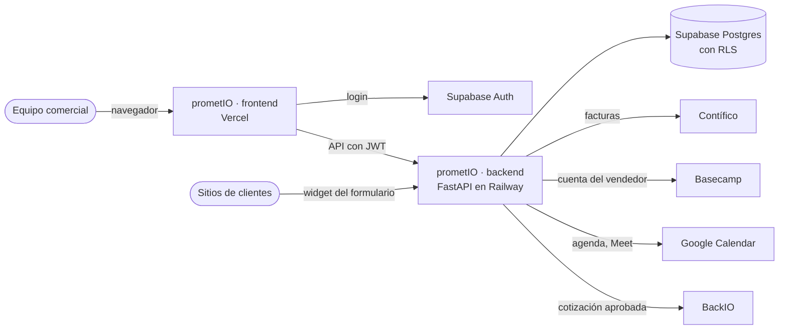

# Por dónde empezar

prometIO es el CRM interno de Geeks Ecuador: contactos y empresas, pipeline comercial, cotizaciones con márgenes,
documentos de alcance, contratos de fee recurrente, facturación y los tableros del equipo comercial. No es un CRM
comprado: está construido a la medida del modelo de negocio de una agencia full-service.

Esta documentación está escrita para personas. Cada página dice qué hace una parte del sistema y por qué funciona así.
Si algo de lo que lees no coincide con lo que ves en prometIO, la página está desactualizada: avísalo o corrígela (los
archivos viven en `docs/` del repositorio `prometio-frontend`).

## Según lo que vengas a hacer

| Si quieres… | Lee |
|---|---|
| Entender qué es prometIO y sus reglas | [Arquitectura y reglas](./00-arquitectura.md) |
| Saber qué puede ver y hacer cada rol | [Roles y permisos](./01-roles-permisos.md) |
| Entender el pipeline y las etapas | [Pipeline y oportunidades](./02-pipeline.md) |
| Saber cómo se calcula el precio de una cotización | [Cotizaciones y motor de márgenes](./03-cotizaciones.md) |
| Entender los fees mensuales y la facturación | [Contratos de fee y facturación](./05-contratos-facturacion.md) |
| Saber de dónde sale cada número del dashboard | [Dashboard, metas y forecast](./06-dashboard.md) |
| Resolver algo que no funciona | [Operar prometIO: cuando algo falla](./operacion.md) |
| Tocar el código por primera vez | [Levantar el proyecto en local](./12-setup.md) y luego [Arquitectura del frontend](./15-arquitectura-frontend.md) |
| Integrar otro sistema | [Integraciones](./11-integraciones.md) y el [mapa de la API](./18-api.md) |
| Saber por qué algo se decidió así | [Registro de decisiones](./decisiones.md) |
| Entender una palabra del dominio | [Glosario](./glosario.md) |

## El sistema en una imagen

- **El frontend no escribe la base de datos.** Todo pasa por la API del backend, que valida permisos y reglas de
  negocio. Supabase en el navegador solo se usa para iniciar sesión.
- **Los montos que ves en pantalla son sin IVA.** El IVA solo aparece en el PDF que recibe el cliente.
- **Los permisos los decide el servidor.** Si la interfaz oculta un botón es por comodidad; la barrera real está en el
  backend y en las políticas de la base.

## Cómo está organizada esta documentación

- **Cómo funciona prometIO:** el comportamiento del sistema, sin necesidad de leer código.
- **Operación:** lo necesario para mantenerlo andando.
- **Referencia técnica:** para quien cambia el código.
- **Decisiones:** el porqué de las reglas.
- **Historia:** el plan original por fases y el registro del endurecimiento. Sirven de contexto, pero no describen el
  sistema de hoy.
